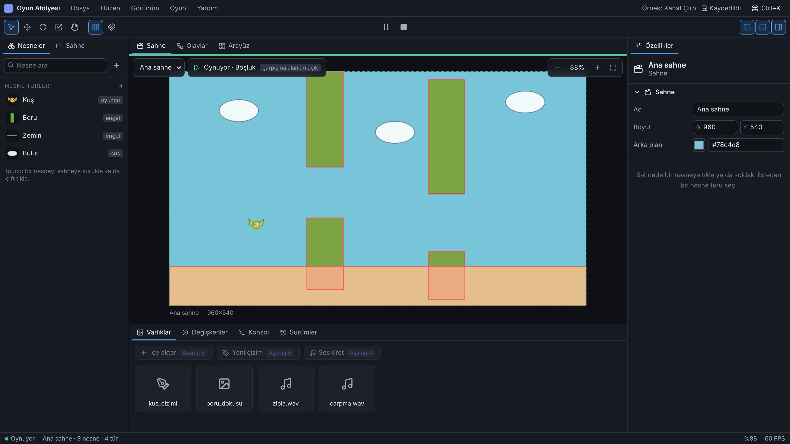
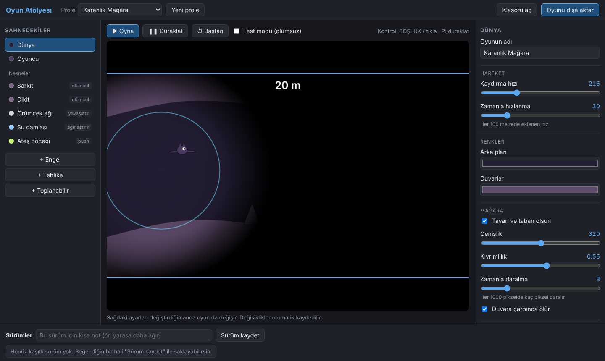

# Çalışma Günlüğü

En yeni girdi en üsttedir.

## 2026-11-14 (gece) — Oyun motoru: fizik, çarpışma ve hazır davranışlar
**Bu gece yapılanlar**
- ▶ Oynat artık gerçek bir **oyun motoru** çalıştırıyor (önceki "basit önizleme" gitti). Bu motor
  editörden ayrı; ileride dışa aktarılan oyunlar da aynısını kullanacak.
  - **Fizik:** yerçekimi, başlangıç hızı, en yüksek hız ve sürtünme ayarları gerçekten çalışıyor.
  - **Çarpışma:** nesnelerin daire ya da kutu biçimli çarpışma alanı var. "İçinden geçilemez"
    işaretli nesnelerin içinden geçilmiyor: örnekte kuş artık zeminin üstünde duruyor, borulara
    çarpınca itiliyor. (Çarpınca oyunun bitmesi gibi sonuçlar Aşama 2'deki olay kurallarıyla gelecek.)
  - Oyun her bilgisayarda aynı hızda ilerliyor (ekranın kare hızından bağımsız).
- **Hazır davranışlar** yenilendi ve ayarları gerçekten çalışıyor:
  - **Tuşla zıpla / uç:** tuşu seçebiliyorsun (Boşluk, ok tuşları, W/A/S/D, Enter, fare tıklaması).
  - **Sabit hızla kay:** hız ve artık **yön** de var (sola, sağa, yukarı, aşağı).
  - **Ekrandan çıkınca yok ol:** sahnenin dışına çıkan nesne silinir; sahnenin dışında doğan
    nesneler (ileride borular böyle doğacak) önce içeri girene kadar silinmez.
  - Yeni davranış eklemek artık tek dosyalık iş (benim için; sana fark etmez ama ileride hızlanır).
- **Görünüm > Çarpışma alanlarını göster** (Ctrl+Shift+C): kırmızı = içinden geçilemez,
  yeşil = değince haber verir ama geçilir. Ayarlar penceresinde de var.
- Oynarken üstteki şerit hangi tuşla oynandığını yazıyor ("Oynuyor · Boşluk").
- Oynarken W/E/R/H/V tuşları artık araç değiştirmiyor (oyun tuşu olabilecekleri için).
- Testler: 20 motor birim testi + Chrome'da 32 otomatik kontrol, hepsi geçiyor.

**Nasıl denenir**
- GitHub Desktop: **Fetch origin → Pull origin**, sonra `exe_yap.bat`, sonra `OyunAtolyesi.exe`.
- "Örnek: Kanat Çırp"ı aç, ▶ Oynat (F5). Kuş zemine düşüp durmalı; Boşluk'la uçmalı; borular sola kaymalı.
- Kuş'u seç → sağda Davranışlar → Tuş'u "Yukarı ok" yap, tekrar oynat: artık ok tuşuyla uçuyor.
- Görünüm menüsünden "Çarpışma alanlarını göster"i aç, oynat ve çerçeveleri gör.
- Boru'nun "Sabit hızla kay" yönünü "Sağa" yapmayı dene.

**Ekran görüntüleri**

**Küçük kararlar (ben seçtim, istersen değiştiririz)**
- Sürtünme 0–1 arası: her 0,1 saniyede yatay hızın bu oranı kaybolur (0,2 → 1 saniyede hız neredeyse biter).
- Döndürülmüş kutu biçimli nesnelerde çarpışma alanı, nesneyi saran düz bir kutu olarak hesaplanıyor.
  Eğik engeller için daha hassas çarpışma (çokgen) gerekirse sonra eklenir.

**Senin kararın gereken konular**
- Şimdilik yok.

**Sıradaki adım**
- Sahne düzenleyiciyi tamamlamak: köşelerden boyutlandırma, üstteki tutamaçtan döndürme, çoklu seçim,
  ok tuşlarıyla kaydırma, hizalama. Ardından geri al / yinele.

## 2026-11-14 (akşam) — v0.2: yeni arayüz
**Bugün yapılanlar** (Harun'la birlikte)
- Araç, genel amaçlı bir oyun yapım ortamı olacak şekilde **baştan kuruldu**. Yeni, modern arayüz:
  - **Başlangıç ekranı:** projelerin ve şablonlar.
  - **Üstte** menüler (Dosya, Düzen, Görünüm, Oyun, Yardım) ve araç çubuğu: seç, taşı, döndür,
    ölçekle, kaydır, ızgara, mıknatıs, ▶ oynat / ■ durdur, panelleri aç-kapa.
  - **Sol:** nesne türleri (sahneye sürükle-bırak) ve sahne ağacı (sahneler, katmanlar, nesneler).
  - **Orta:** sahne düzenleyici (yakınlaştırma, kaydırma, ızgara), olay kuralları sayfası
    (şimdilik okunur önizleme) ve arayüz düzenleyici (yakında).
  - **Sağ:** özellikler. Nesnelere "bileşen" ekleniyor: Görünüm, Fizik, Çarpışma, Işık, Davranışlar.
  - **Alt:** varlıklar, değişkenler, konsol, sürümler.
  - **Ctrl+K** komut paleti, **F1** kısayollar, ayarlar penceresi.
- ▶ ile basit bir önizleme çalışıyor (yerçekimi, zıplama, kayma). Çarpışma ve kurallar sonraki işler.
- Eski projelerin (Karanlık Mağara gibi) açılınca yeni biçime dönüştürülüyor.
- Bir oyun aracında olması gereken bütün özelliklerin listesi: **OZELLIKLER.md**.
- Otomatik test: arayüzün tamamını Chrome'da kullanan 20 kontrol + birim testleri, hepsi geçiyor.

**Nasıl denenir**
- GitHub Desktop: **Fetch origin → Pull origin**, sonra `exe_yap.bat`, sonra `OyunAtolyesi.exe`.
- "Örnek: Kanat Çırp" projesini aç, nesnelere tıkla, sürükle, sağdan ayarlarla oyna, ▶ ile dene.

**Ekran görüntüleri**

**Sıradaki adım**
- Gece çalışması: motor çekirdeği (fizik + çarpışma), ardından hazır davranışlar.

## 2026-11-14 — v0.1
**Bugün yapılanlar**
- Oyun Atölyesi'nin ilk sürümü hazır. Uygulama penceresinde:
  - **Sol:** Dünya, Oyuncu ve nesnelerin listesi; "+ Engel", "+ Tehlike", "+ Toplanabilir" ile ekleme.
  - **Orta:** Canlı oyun önizlemesi (Oyna, Duraklat, Baştan, ölümsüz Test modu).
  - **Sağ:** Seçili şeyin bütün ayarları: kaydırıcılar, renk seçiciler, açılır menüler.
    Değiştirdiğin anda oyun da değişir.
  - **Alt:** Sürüm kaydetme ve eski sürüme geri dönme.
  - **Üst:** Proje seçme, yeni proje (şablondan), oyunu dışa aktarma, klasörü açma.
- Nesnelerin dokununca yapabileceği 7 etki: oyunu bitirir, yavaşlatır, ağırlaştırır,
  kanadı zayıflatır, sersemletir, puan verir, kalkan verir.
- İki örnek proje: **Karanlık Mağara** (Yankı benzeri) ve **Kuş Uçuşu**.
- Değişiklikler otomatik kaydediliyor (Belgeler\OyunAtolyesi).

**Nasıl denenir**
- README'deki "İlk kurulum" adımlarıyla `exe_yap.bat` → `OyunAtolyesi.exe`.

**Ekran görüntüleri**

**Senin kararın gereken konular**
- Sıradaki büyük adım için tercihin: kendi şekillerini çizebileceğin bir çizim editörü mü,
  yoksa enerji/özel yetenek/bölüm gibi oyun kuralları mı?

**Sıradaki adım**
- Senin ilk kullanım yorumların, ardından YAPILACAKLAR'daki ilk işler.
