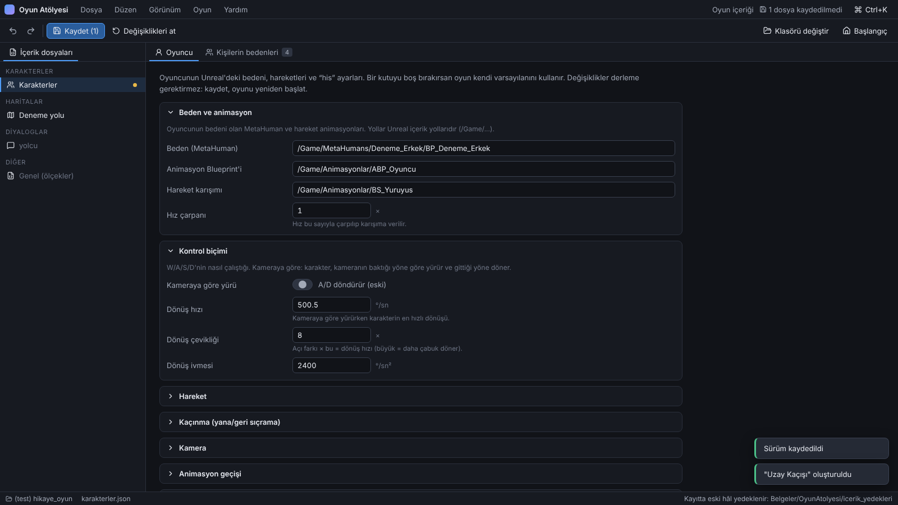
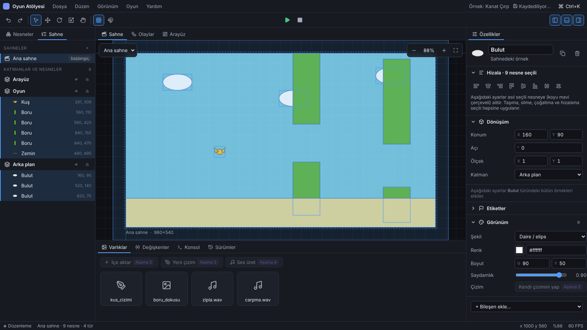
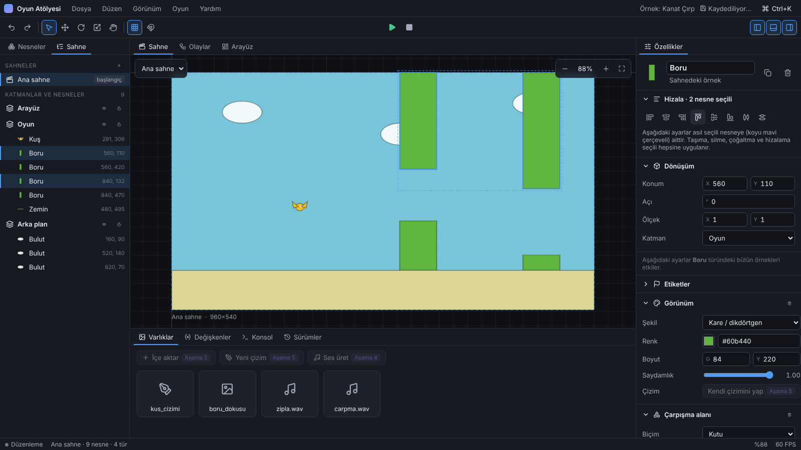
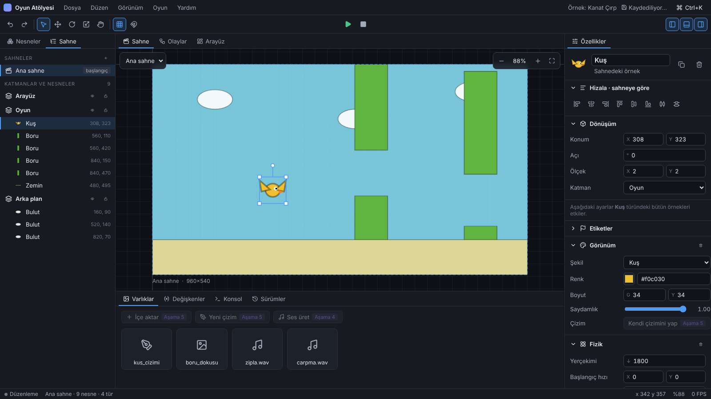
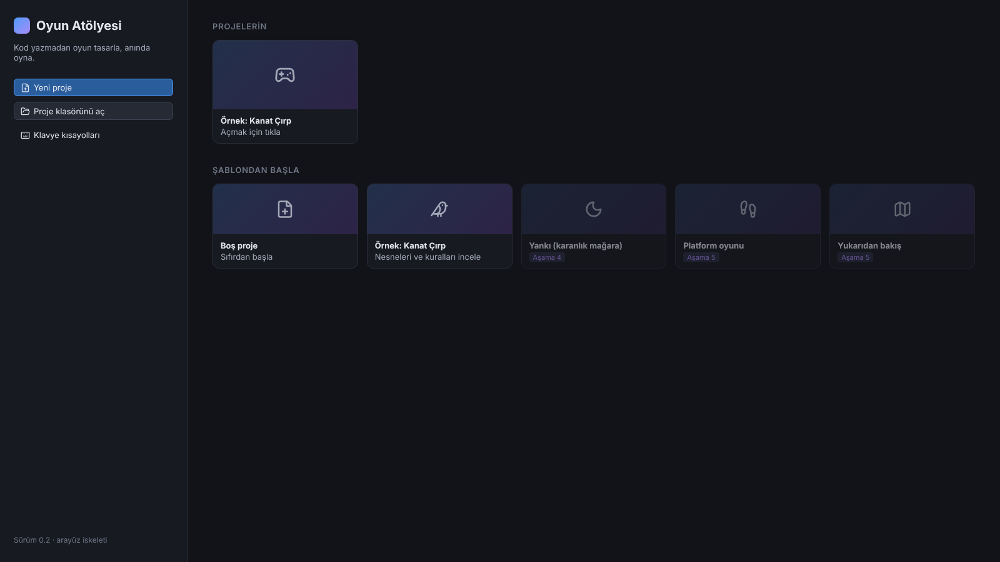
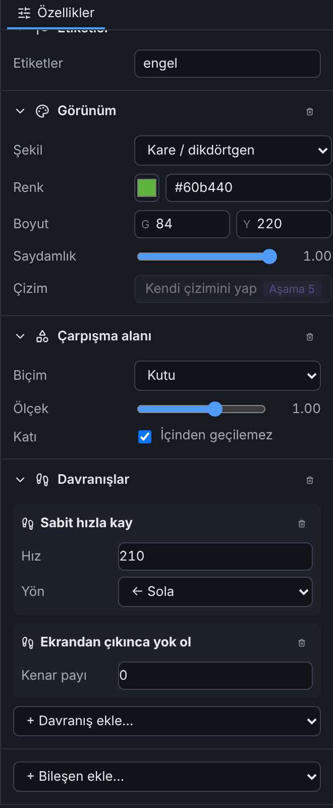
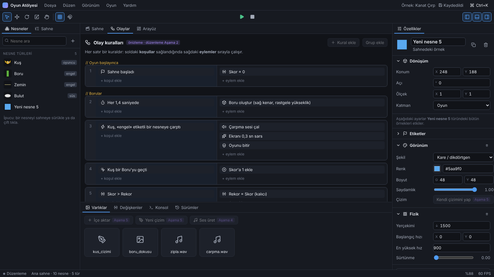
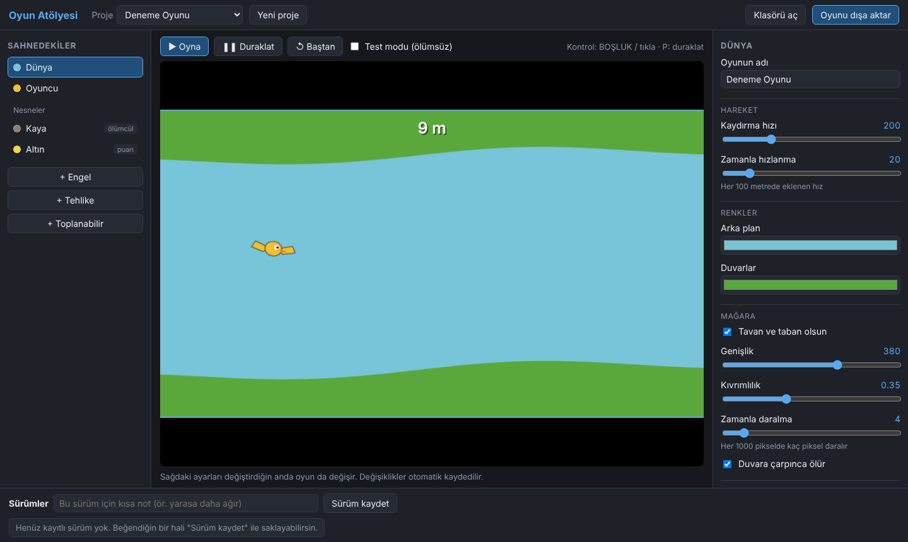

# Çalışma Günlüğü

En yeni girdi en üsttedir.

## 2026-11-16 (gece) — Oyununun içeriği artık Atölye'de düzenlenebiliyor
**Bu gece yapılanlar**
- Başlangıç ekranına yeni bir düğme geldi: **Oyun içeriğini aç**. Bu, 3D hikâye oyununun (hikaye_oyun)
  dosyalarını açan yepyeni bir ekran. İlk seferde senden oyunun klasörünü seçmeni istiyor (GitHub Desktop'un
  indirdiği `hikaye_oyun` klasörü); sonra hatırlıyor.
- **Karakterler → Oyuncu:** Oyuncunun bütün ayarları kartlar halinde: MetaHuman bedeni ve animasyon yolları,
  **Kontrol biçimi** (yeni "Kameraya göre yürü" anahtarı ve dönüş hızı/çevikliği/ivmesi), hareket hızları, kaçınma,
  kamera, dövüş, doğallık (beden dili), etkileşim anları, çanta ve bütün animasyon yolları. Her sayının yanında birimi
  (cm/sn, °, sn) ve kısa bir açıklama var. Oyuna ileride yeni bir ayar eklersem, açıklamasını yazmasam bile ilgili kartta
  "yeni" rozetiyle görünür ve değiştirilebilir.
- **Karakterler → Kişilerin bedenleri:** Haritadaki her kişinin (Yolcu, Bekleyen kişi, Gezginler) MetaHuman bedenini
  seçtiğin yer. Haritada olup bedeni olmayan kişiler için hazır "+ ekle" düğmeleri çıkıyor.
- **Harita → Eşyalar:** Yerdeki alınabilir eşyalar (defter, çiçek…). Üstte haritanın **krokisi** var: yol, kapılar, kişilerin
  dolaşma alanları ve eşyalar üstten görünüyor; **bir eşyayı fareyle sürükleyerek yerini değiştirebiliyorsun**.
  Her eşyanın adı, rengi, mesajı, puanları (ölçek seç + sayı) ve isteğe bağlı "elde duruşu" düzenleniyor. Eşya ekle, çoğalt, sil.
- **Harita → Harita ayarları:** Unreal'deki model açı düzeltmesi, zemin ve yol malzeme klasörleri ve karo boyları,
  yolun boyu/genişliği/renkleri, ışık ve gökyüzü, başlangıç ve bitiş.
- Yanlış yazılan bir şey (ör. `/Game/` ile başlamayan bir Unreal yolu ya da Türkçe harfli bir kimlik) sarı uyarıyla gösteriliyor.
- **Güvenlik:** Hiçbir şey kendiliğinden kaydedilmiyor; **Kaydet** (Ctrl+S) değişen dosyaları birden yazıyor ve her kayıttan önce
  eski hâli `Belgeler\OyunAtolyesi\icerik_yedekleri` klasörüne kopyalıyor. Dosyada bu ekranda görünmeyen şeylere (ör. 83 dekor
  nesnesi) dokunulmuyor. Ctrl+Z / Ctrl+Y burada da çalışıyor. Kaydetmeden çıkmaya kalkarsan bir kez daha soruyor.
- Diyaloglar ve diğer dosyalar şimdilik yalnızca okunuyor (düzenleyicileri Aşama 4'te).
- Testler: 35 birim testi + Chrome'da 74 otomatik kontrol (27'si bu gece eklendi) ve dosya işleri testi; hepsi geçiyor.

**Nasıl denenir**
1. GitHub Desktop: **Fetch origin → Pull origin** (hem `oyun_atolyesi` hem `hikaye_oyun` için), sonra `exe_yap.bat`, sonra `OyunAtolyesi.exe`.
2. Başlangıç ekranında **Oyun içeriğini aç** → açılan pencerede `hikaye_oyun` klasörünü seç.
3. **Karakterler → Kontrol biçimi**'nde "Kameraya göre yürü" anahtarını kapat, **Kaydet**. Unreal'de oyunu başlat:
   A/D artık karakteri döndürmeli (eski biçim). Sonra anahtarı yeniden aç ve kaydet.
4. **Deneme yolu → Eşyalar**: krokide "Eski bir defter"i yolun öbür yanına sürükle, adını değiştir, **+ Puan ekle** de, kaydet.
   Oyunda defter yeni yerinde ve yeni adıyla ("[F] Al: …") görünmeli.
5. GitHub Desktop'ta `hikaye_oyun` deposunda yalnızca değiştirdiğin satırların değiştiğini görebilirsin.

**Ekran görüntüleri**

**Küçük kararlar (ben seçtim, istersen değiştiririz)**
- Oyun içeriği **otomatik kaydedilmiyor** (2D projelerden farklı): oyunun dosyalarına sen "Kaydet" demeden yazmak istemedim.
- Kroki **yaklaşık** bir üstten görünüş; yol soldan sağa ilerliyor. Gerçek 3D görünüm Aşama 2'de gelecek.
- Bir kutuyu boş bırakmak "oyunun varsayılanını kullan" demek (alan dosyadan silinir).
- Sayıların biçimi: dosyada `1.0` yazan bir değer kaydedince `1` olarak yazılıyor; oyun ikisini aynı okuyor.

**Senin kararın gereken konular**
- Sırada iki seçenek var, hangisini önce istersin?
  **(A)** Aynı ekranda kişilerin dolaşma alanlarını ve kapı seçimlerini krokiden düzenlemek (hızlı, hemen işe yarar), ya da
  **(B)** doğrudan 3D görünüme (Aşama 2) geçmek. Bir şey demezsen önce (A)'yı yapacağım.

**Sıradaki adım**
- Oyun içeriği ekranında kişiler (dolaşma alanı, hız, konuşma) ve kapı seçimleri.

## 2026-11-15 (gece) — Sahne düzenleyici tamam, geri al / yinele geldi (Aşama 1 bitti)
**Bu gece yapılanlar**
- **Geri al / yinele** artık çalışıyor: **Ctrl+Z** geri alır, **Ctrl+Y** yeniden yapar. Araç çubuğunun
  en solunda iki ok düğmesi de var. Bir nesneyi sürüklemek, bir kutuya bir kelime yazmak ya da ok tuşuna
  art arda basmak **tek adım** sayılıyor; yani tek Ctrl+Z ile hepsi geri geliyor. 200 adım geriye gidebilirsin.
  Bir sürümü geri yüklemek de geri alınabiliyor.
- **Tutamaçlar:** Bir nesne seçince köşelerdeki beyaz kareleri sürükleyerek **boyutlandırabiliyorsun**
  (karşı köşe yerinde kalır; Shift basılıysa oranı korunur). Üstteki yuvarlağı sürükleyerek
  **döndürebiliyorsun**; Döndür aracını seçmen gerekmiyor (Shift ile 15°'lik adımlar).
- **Çoklu seçim:** **Shift+tık** ile nesne ekle/çıkar, **boş bir yerden sürükleyerek kutu** çiz,
  **Ctrl+A** ile hepsini seç, **Esc** ile bırak. Seçili nesneleri birlikte taşıyabilir, silebilir,
  çoğaltabilirsin. Sol paneldeki sahne ağacında da Shift/Ctrl ile çoklu seçim var.
- **Ok tuşları:** seçili nesneleri 1 piksel, Shift ile 10 piksel kaydırır.
- **Hizalama:** Düzen menüsünde yeni **Hizala** bölümü ve sağ panelde **Hizala** kartı (8 düğme):
  sola/ortaya/sağa, üste/ortaya/alta hizala, yatay/dikey eşit dağıt. Tek nesne seçiliyse sahneye göre
  hizalar (ör. "Yatay ortala" nesneyi sahnenin tam ortasına koyar).
- Menülerdeki "Aşama 1" rozetleri kalktı. Böylece **Aşama 1 (Çekirdek) tamamlandı.**
- Testler: 25 birim testi + Chrome'da 47 otomatik kontrol (15'i bu gece eklendi), hepsi geçiyor.

**Nasıl denenir**
- GitHub Desktop: **Fetch origin → Pull origin**, sonra `exe_yap.bat`, sonra `OyunAtolyesi.exe`.
- "Örnek: Kanat Çırp"ı aç. Kuş'a tıkla, sağ alt köşedeki beyaz kareyi dışarı sürükle → kuş büyür.
  Üstteki yuvarlağı çevir → kuş döner. Sonra **Ctrl+Z**'ye iki kez bas → ikisi de geri gelir.
- Sahnenin dışındaki koyu alandan başlayıp bütün sahneyi kapsayan bir kutu çiz → her şey seçilir.
  **Delete** → hepsi silinir. **Ctrl+Z** → hepsi geri gelir.
- İki boruya Shift ile tıkla, sağdaki **Hizala** kartından "Üste hizala"yı dene.
- Bir nesne seçip ok tuşlarıyla (ve Shift+ok ile) oynat.

**Ekran görüntüleri**

**Küçük kararlar (ben seçtim, istersen değiştiririz)**
- Hizalama kısayolları **Alt+A/H/D** (sol/orta/sağ) ve **Alt+W/V/S** (üst/orta/alt). W/A/S/D yön tuşlarına benzesin diye seçtim.
- Birden fazla nesne seçiliyken sağ panel yalnızca "asıl seçili" (ilk tıkladığın, koyu mavi çerçeveli)
  nesnenin ayarlarını gösteriyor. Hepsinin ayarını birlikte değiştirmek gerekirse sonra eklerim.
- Kutu seçimi, kutuya **değen** nesneleri seçiyor (tamamen içinde olmasına gerek yok).
- Geri al geçmişi proje kapanınca sıfırlanıyor (kalıcı yedek için Sürümler var).

**Senin kararın gereken konular**
- Aşağıdaki haftalık incelemedeki sorulara bakabilirsin.

**Sıradaki adım**
- Aşama 2: aracın ortasına **3D Harita** sekmesi (three.js ile döndürülebilir 3D görünüm, ızgara zemin).

## Haftalık inceleme (9–15 Kasım 2026)
*(Bu inceleme Pazar gecesi çalışmasında yazıldı; İstanbul saatiyle gece yarısını biraz geçmişti.)*

**Bu hafta neler eklendi**
- **v0.1:** yarasa oyununa özel ilk ayar paneli (artık `eski_v01/` altında duruyor).
- **v0.2:** baştan yeni, modern arayüz — menüler, araç çubuğu, paneller, komut paleti (Ctrl+K),
  nesne türleri ve bileşenler (Görünüm, Fizik, Çarpışma, Işık, Davranışlar), sürümler, değişkenler.
- **Oyun motoru:** gerçek fizik, çarpışma, içinden geçilemeyen nesneler; 3 hazır davranış
  (tuşla zıpla, sabit hızla kay, ekrandan çıkınca yok ol); çarpışma alanlarını gösterme.
- **Yön kararı (senin):** araç, **3D hikâye oyununun içerik editörü** olacak; 2D hedefi ertelendi.
  Oyun bu hafta Unreal Engine'e geçti; içerik yine aynı JSON dosyalarında, yani araç için yol değişmedi.
- **Bu gece:** sahne düzenleyici tamamlandı ve geri al / yinele geldi → **Aşama 1 bitti.**

**Bu hafta denemen gereken 5 şey**
1. **Güncelle:** GitHub Desktop → Fetch origin → Pull origin → `exe_yap.bat` → `OyunAtolyesi.exe`.
2. **Geri al:** Örnek projede birkaç nesneyi sürükle, sil, rengini değiştir; sonra Ctrl+Z'ye art arda
   basıp her şeyin sırayla geri geldiğini gör, Ctrl+Y ile ileri al.
3. **Tutamaçlar:** Bir boruyu seç, köşesinden uzat, üstteki yuvarlakla eğ. Shift basılıyken tekrar dene.
4. **Çoklu seçim + hizalama:** Bulutları kutu ile seç (boş yerden sürükle), sağdaki Hizala kartından
   "Üste hizala" ve "Yatay eşit dağıt"ı dene.
5. **Oyna:** F5 ile oyunu başlat, Boşluk ile kuşu uçur; Görünüm → "Çarpışma alanlarını göster"i açıp tekrar oyna.

**Ekran görüntüsü serisi**

**Tasarım ve yön soruları** (birini seçmen yeterli; sohbette ya da GERI_BILDIRIM.md'ye yazabilirsin)
1. **3D görünüm nerede dursun?**
   a) Ortadaki sekmelere "3D Harita" diye yeni bir sekme (Sahne/Olaylar/Arayüz'ün yanına) — *benim önerim*
   b) 3D projeler açılınca 2D sahne tamamen 3D görünümle yer değiştirsin
   c) Ekran ikiye bölünsün: solda üstten 2D harita, sağda 3D görünüm
2. **3D'de kamera nasıl dönsün?**
   a) Unreal gibi: sağ tık basılıyken fareyle bak, W/A/S/D ile uç — *oyun Unreal'de olduğu için önerim*
   b) Blender/Godot gibi: orta tuşla bir noktanın etrafında dön
   c) İkisi de olsun, Ayarlar'dan seçilsin
3. **İlk hangi içerik editörü gelsin?** (3D görünüm hazır olunca)
   a) Harita: modelleri yerleştirme, ışık ve gökyüzü
   b) Karakter oluşturma ekranının seçenekleri (kaydırıcılar, sorular, puanlar)
   c) Konuşma ağacı (diyalog) düzenleyici
4. **Araç oyunun dosyalarına nasıl bağlansın?**
   a) Araçta "Oyun klasörünü seç" düğmesi; araç doğrudan oyunun `icerik/` klasörünü düzenler — *önerim*
   b) Araç kendi kopyasında çalışsın, "Oyuna gönder" deyince dosyaları oyuna kopyalasın

**Gelecek haftanın planı**
- 3D Harita sekmesi: döndürülebilir kamera, ızgara zemin, eksen göstergesi.
- glTF/GLB modelleri yükleyip gösterme; varlık listesinde 3D küçük resimler.
- 3D'de seçme ve taşı/döndür/ölçekle tutamaçları (bu gece yapılan geri al ve çoklu seçim altyapısı kullanılacak).
- Fırsat kalırsa: güneş yönü, gökyüzü rengi ve sis önizlemesi.

## 2026-11-14 (gece) — Oyun motoru: fizik, çarpışma ve hazır davranışlar
**Bu gece yapılanlar**
- ▶ Oynat artık gerçek bir **oyun motoru** çalıştırıyor (önceki "basit önizleme" gitti). Bu motor
  editörden ayrı; ileride dışa aktarılan oyunlar da aynısını kullanacak.
  - **Fizik:** yerçekimi, başlangıç hızı, en yüksek hız ve sürtünme ayarları gerçekten çalışıyor.
  - **Çarpışma:** nesnelerin daire ya da kutu biçimli çarpışma alanı var. "İçinden geçilemez"
    işaretli nesnelerin içinden geçilmiyor: örnekte kuş artık zeminin üstünde duruyor, borulara
    çarpınca itiliyor. (Çarpınca oyunun bitmesi gibi sonuçlar Aşama 2'deki olay kurallarıyla gelecek.)
  - Oyun her bilgisayarda aynı hızda ilerliyor (ekranın kare hızından bağımsız).
- **Hazır davranışlar** yenilendi ve ayarları gerçekten çalışıyor:
  - **Tuşla zıpla / uç:** tuşu seçebiliyorsun (Boşluk, ok tuşları, W/A/S/D, Enter, fare tıklaması).
  - **Sabit hızla kay:** hız ve artık **yön** de var (sola, sağa, yukarı, aşağı).
  - **Ekrandan çıkınca yok ol:** sahnenin dışına çıkan nesne silinir; sahnenin dışında doğan
    nesneler (ileride borular böyle doğacak) önce içeri girene kadar silinmez.
  - Yeni davranış eklemek artık tek dosyalık iş (benim için; sana fark etmez ama ileride hızlanır).
- **Görünüm > Çarpışma alanlarını göster** (Ctrl+Shift+C): kırmızı = içinden geçilemez,
  yeşil = değince haber verir ama geçilir. Ayarlar penceresinde de var.
- Oynarken üstteki şerit hangi tuşla oynandığını yazıyor ("Oynuyor · Boşluk").
- Oynarken W/E/R/H/V tuşları artık araç değiştirmiyor (oyun tuşu olabilecekleri için).
- Testler: 20 motor birim testi + Chrome'da 32 otomatik kontrol, hepsi geçiyor.

**Nasıl denenir**
- GitHub Desktop: **Fetch origin → Pull origin**, sonra `exe_yap.bat`, sonra `OyunAtolyesi.exe`.
- "Örnek: Kanat Çırp"ı aç, ▶ Oynat (F5). Kuş zemine düşüp durmalı; Boşluk'la uçmalı; borular sola kaymalı.
- Kuş'u seç → sağda Davranışlar → Tuş'u "Yukarı ok" yap, tekrar oynat: artık ok tuşuyla uçuyor.
- Görünüm menüsünden "Çarpışma alanlarını göster"i aç, oynat ve çerçeveleri gör.
- Boru'nun "Sabit hızla kay" yönünü "Sağa" yapmayı dene.

**Ekran görüntüleri**

**Küçük kararlar (ben seçtim, istersen değiştiririz)**
- Sürtünme 0–1 arası: her 0,1 saniyede yatay hızın bu oranı kaybolur (0,2 → 1 saniyede hız neredeyse biter).
- Döndürülmüş kutu biçimli nesnelerde çarpışma alanı, nesneyi saran düz bir kutu olarak hesaplanıyor.
  Eğik engeller için daha hassas çarpışma (çokgen) gerekirse sonra eklenir.

**Senin kararın gereken konular**
- Şimdilik yok.

**Sıradaki adım**
- Sahne düzenleyiciyi tamamlamak: köşelerden boyutlandırma, üstteki tutamaçtan döndürme, çoklu seçim,
  ok tuşlarıyla kaydırma, hizalama. Ardından geri al / yinele.

## 2026-11-14 (akşam) — v0.2: yeni arayüz
**Bugün yapılanlar** (Harun'la birlikte)
- Araç, genel amaçlı bir oyun yapım ortamı olacak şekilde **baştan kuruldu**. Yeni, modern arayüz:
  - **Başlangıç ekranı:** projelerin ve şablonlar.
  - **Üstte** menüler (Dosya, Düzen, Görünüm, Oyun, Yardım) ve araç çubuğu: seç, taşı, döndür,
    ölçekle, kaydır, ızgara, mıknatıs, ▶ oynat / ■ durdur, panelleri aç-kapa.
  - **Sol:** nesne türleri (sahneye sürükle-bırak) ve sahne ağacı (sahneler, katmanlar, nesneler).
  - **Orta:** sahne düzenleyici (yakınlaştırma, kaydırma, ızgara), olay kuralları sayfası
    (şimdilik okunur önizleme) ve arayüz düzenleyici (yakında).
  - **Sağ:** özellikler. Nesnelere "bileşen" ekleniyor: Görünüm, Fizik, Çarpışma, Işık, Davranışlar.
  - **Alt:** varlıklar, değişkenler, konsol, sürümler.
  - **Ctrl+K** komut paleti, **F1** kısayollar, ayarlar penceresi.
- ▶ ile basit bir önizleme çalışıyor (yerçekimi, zıplama, kayma). Çarpışma ve kurallar sonraki işler.
- Eski projelerin (Karanlık Mağara gibi) açılınca yeni biçime dönüştürülüyor.
- Bir oyun aracında olması gereken bütün özelliklerin listesi: **OZELLIKLER.md**.
- Otomatik test: arayüzün tamamını Chrome'da kullanan 20 kontrol + birim testleri, hepsi geçiyor.

**Nasıl denenir**
- GitHub Desktop: **Fetch origin → Pull origin**, sonra `exe_yap.bat`, sonra `OyunAtolyesi.exe`.
- "Örnek: Kanat Çırp" projesini aç, nesnelere tıkla, sürükle, sağdan ayarlarla oyna, ▶ ile dene.

**Ekran görüntüleri**

**Sıradaki adım**
- Gece çalışması: motor çekirdeği (fizik + çarpışma), ardından hazır davranışlar.

## 2026-11-14 — v0.1
**Bugün yapılanlar**
- Oyun Atölyesi'nin ilk sürümü hazır. Uygulama penceresinde:
  - **Sol:** Dünya, Oyuncu ve nesnelerin listesi; "+ Engel", "+ Tehlike", "+ Toplanabilir" ile ekleme.
  - **Orta:** Canlı oyun önizlemesi (Oyna, Duraklat, Baştan, ölümsüz Test modu).
  - **Sağ:** Seçili şeyin bütün ayarları: kaydırıcılar, renk seçiciler, açılır menüler.
    Değiştirdiğin anda oyun da değişir.
  - **Alt:** Sürüm kaydetme ve eski sürüme geri dönme.
  - **Üst:** Proje seçme, yeni proje (şablondan), oyunu dışa aktarma, klasörü açma.
- Nesnelerin dokununca yapabileceği 7 etki: oyunu bitirir, yavaşlatır, ağırlaştırır,
  kanadı zayıflatır, sersemletir, puan verir, kalkan verir.
- İki örnek proje: **Karanlık Mağara** (Yankı benzeri) ve **Kuş Uçuşu**.
- Değişiklikler otomatik kaydediliyor (Belgeler\OyunAtolyesi).

**Nasıl denenir**
- README'deki "İlk kurulum" adımlarıyla `exe_yap.bat` → `OyunAtolyesi.exe`.

**Ekran görüntüleri**

**Senin kararın gereken konular**
- Sıradaki büyük adım için tercihin: kendi şekillerini çizebileceğin bir çizim editörü mü,
  yoksa enerji/özel yetenek/bölüm gibi oyun kuralları mı?

**Sıradaki adım**
- Senin ilk kullanım yorumların, ardından YAPILACAKLAR'daki ilk işler.
