# Çalışma Günlüğü

En yeni girdi en üsttedir.

> **2026-11-27 (gece) — Yankı gecesi:** bölümler geldi (menüde bölüm listesi, bölüm sonu ve en iyi süre); ayarlar ve bölümler artık `yanki/icerik/yanki.json`'da, Atölye'den düzenlenmeye hazır (ayrıntı: [yanki/GUNLUK.md](yanki/GUNLUK.md)).

> **2026-11-25 (gece) — Yankı gecesi:** örümcek ağları ve su damlaları (öldürmeyen tehlikeler) (ayrıntı: [yanki/GUNLUK.md](yanki/GUNLUK.md)).

> **2026-11-23 (gece) — Yankı gecesi:** sarkıt ve dikitler, duraklat düğmesi, yumuşak başlangıç (ayrıntı: [yanki/GUNLUK.md](yanki/GUNLUK.md)).

> **2026-11-21 (gece) — Yankı gecesi:** geniş ekrana tam sığma ve mağaranın akarak belirmesi düzeltildi (ayrıntı: [yanki/GUNLUK.md](yanki/GUNLUK.md)).

> **2026-11-19 (gece) — Yankı gecesi:** mobil yarasa oyunu Yankı'nın telefonda oynanabilen ilk sürümü kuruldu (ayrıntı ve telefonda deneme adımları: [yanki/GUNLUK.md](yanki/GUNLUK.md)).

## 2026-11-26 (gece) — Oyunun menü görünüşü ve oyuncunun yeni ayarları Atölye'de
**Bu gece yapılanlar**
- Sıradaki ilk iş (Yankı düzenleyicisi), Yankı'nın bölüm dosyası henüz hazır olmadığı için bekliyor; o dosya Yankı gecesinde
  hazırlanacak. Bu gece listedeki ikinci işi yaptım.
- Sol listede yeni bir dosya: **Genel → Arayüz (menü ve ekran)**. Oyunun menülerinin görünüşü artık buradan değişiyor:
  - **Renkler** (yazı, vurgu, panel, menü şeridi, karartma…): kutu boşsa oyunun kendi rengi kullanılır. Renk seçince yanında bir
    **saydamlık kaydırıcısı** çıkıyor (ör. menü açıkken arkadaki yarı saydam perde). **Varsayılana dön** rengi boşaltır.
  - **Yazı tipleri, logo, menü müziği** ve **ana menüdeki karakterin ışığı**.
  - **Yapımcılar ekranı:** bölümler ve iki sütunlu satırlar ("iş — kişi"); ekle, sil, oklarla sırala.
- Oyuncu ayarlarında oyuna sonradan eklenmiş, adı ve açıklaması olmayan **59 alan** artık adlı ve açıklamalı (kalan 3 "engel izi" oyunun ölçtüğü
  hareket verisi; elle düzenlenmez, gösterilmiyor):
  **Bankta oturma** kartı (oturuş/kalkış saniyeleri, otururken sırayla oynayan bekleme hareketleri listesi, oturuş yeri ayarları),
  **omuz kamerası**, koşarken kamera, **tekme mesafeleri** ve değdiği anlar, vuruşların "en uzak an"ları, sandık açma ve yerden alma
  ayarları, **16 yeni animasyon** (tekme, tırmanma, engel atlama, kişilerin darbe tepkileri…).
- Oyun dosyasındaki açıklama notları ayrı bir kutu olarak değil, kartın üstünde soluk yazıyla "Oyunun notu" olarak görünüyor.
- Atölye ilk açılışta yine **Karakterler**'i açıyor (yeni dosya alfabede öne geçmesin diye).
- Alan rehberi (ALAN_REHBERI.md) bu yeni alanlarla güncellendi.
- Testler: 45 birim testi + Chrome'da 143 otomatik kontrol (14'ü yeni) ve dosya işleri testi; hepsi geçiyor.

**Ekran görüntüleri:** `gunluk/2026-11-26/arayuz_renkler.png`, `arayuz_yapimcilar.png`, `oyuncu_oturma.png`

**Nasıl denenir**
1. GitHub Desktop: **Fetch origin → Pull origin** (`oyun_atolyesi`), sonra `exe_yap.bat`, sonra `OyunAtolyesi.exe`.
2. **Oyun içeriğini aç → Genel → Arayüz.** "Vurgu" rengini değiştir, **Kaydet**, Unreal'de Play: menüde seçili satır yeni renkte olmalı.
   "Varsayılana dön" deyip kaydedince eski renge döner.
3. **Yapımcılar** kartında bir satır ekle (solda iş, sağda adın), Kaydet: oyunun Yapımcılar ekranında görünmeli.
4. **Karakterler → Oyuncu → Bankta oturma:** "Kalça yüzeyin üstünde" değerini değiştir: karakter oturağa gömülüyorsa artır, havada
   duruyorsa azalt.

**Senin kararın gereken konular**
- Yok.

**Sıradaki adım:** Yankı'nın bölüm dosyası hazır olunca Yankı düzenleyicisi; o zamana kadar seçilebilir bedenler (ana menüdeki
karakter seçimi) ve modeller.json.

## 2026-11-24 (gece) — Köyün kapıları, iç mekânları ve meşaleleri Atölye'de
**Bu gece yapılanlar**
- Haritada yeni bir sekme: **Mekânlar**. Köy meydanındaki **88 kapı** (44 giriş + 44 "Dışarı çık"), **43 meşale** ve haritanın özel
  alanları artık burada düzenleniyor.
- **Kapılar ve geçişler:** her satırda kapının yazısı ("Gir: Han"), kapının yeri ve oyuncunun gideceği yer. ⇄ düğmesi kapının
  **dönüş kapısına** atlıyor. **Kapı çifti ekle** bir giriş ve onun "Dışarı çık" kapısını birlikte ekliyor. Dönüş kapısı olmayan bir
  giriş sarı uyarıyla gösteriliyor (oyuncu içeride mahsur kalmasın).
- **Meşaleler:** direk ya da duvar meşalesi, yeri, yüksekliği, yönü; üstte bütün meşalelerin **ışık gücü** ve **erimi**.
- **İç mekânlar** (Unreal'deki hazır sahneler), **zeminler** (kaldırım, meydan), **görünmez duvarlar** ve **ot serpilmeyen alanlar**.
- **Krokide** kapılar, meşaleler ve alanlar görünüyor ve **sürüklenerek taşınıyor**; listede bir satıra tıklayınca krokide de seçiliyor.
  "Yakın görünüm" artık köyün kendisini gösteriyor (uzaktaki iç mekân kapıları görünümü kaydırmıyor).
- Testler: 41 birim testi + Chrome'da 129 otomatik kontrol (10'u bu gece) ve dosya işleri testi; hepsi geçiyor. Gerçek Köy meydanı
  dosyalarıyla da açtım: 88 kapı ve 43 meşale hatasız ve hızlı (0,3 sn) açılıyor, hiç uyarı yok.

**Nasıl denenir**
1. GitHub Desktop: **Fetch origin → Pull origin** (`oyun_atolyesi` ve `hikaye_oyun`), sonra `exe_yap.bat`, sonra `OyunAtolyesi.exe`.
2. **Oyun içeriğini aç → Köy meydanı → Mekânlar.** Krokide sarı meşale noktalarından birini biraz kaydır, **Kaydet**. Oyunda akşam
   olunca o meşale yeni yerinde yanmalı.
3. "Gir: Han" satırındaki yazıyı "Gir: Han (açık)" yap, **Kaydet**: oyunda hanın kapısına yaklaşınca yeni yazı görünmeli.
4. ⇄ düğmesiyle hanın içindeki "Dışarı çık" kapısına atla; satır seçilir.

**Ekran görüntüleri**
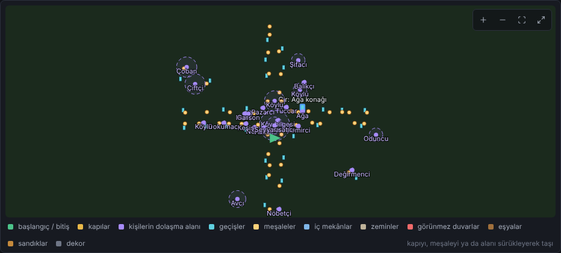
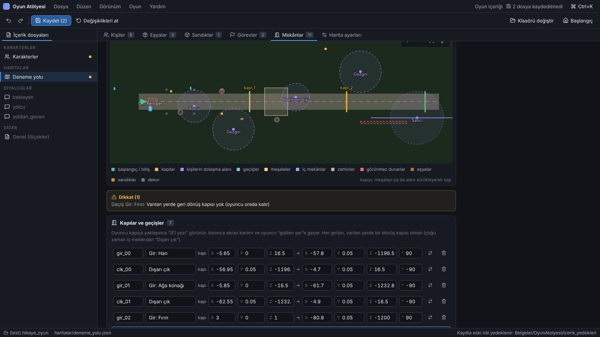
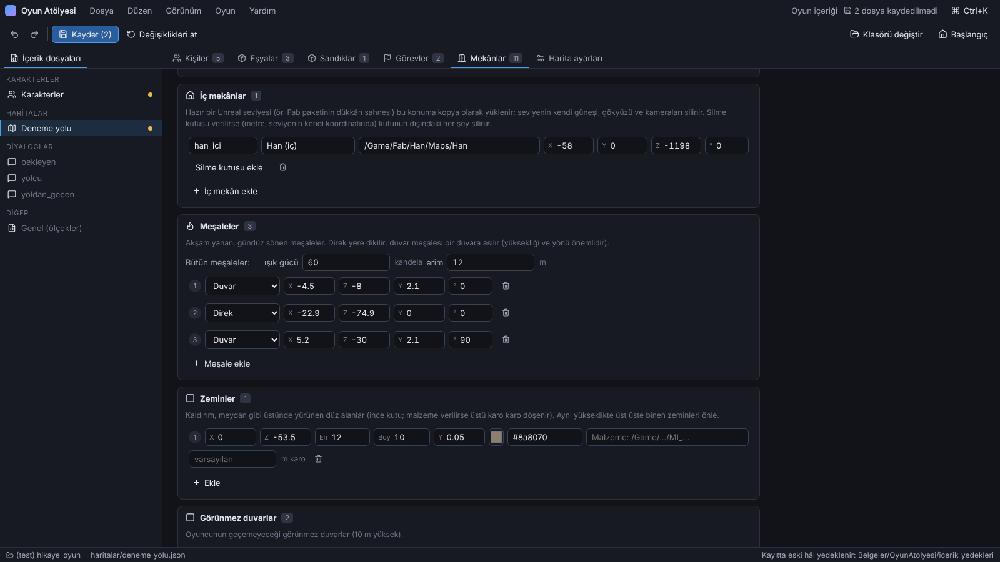

**Küçük kararlar (ben seçtim)**
- Meşale bilgisi BICIM.md'de henüz yazılı değildi; alanları (tür, yer, yükseklik, yön, ışık gücü, erim) oyunun kodundan okudum.
- Listeler uzun olduğu için her kapı/meşale bir **satır** (kart değil); bölümler başlığına tıklayınca kapanıyor.
- Yeni kapı çiftinde iç mekân tarafı köyden uzağa (z = -1200) konuyor; oyundaki iç sahneler de böyle uzakta duruyor.

**Senin kararın gereken konular**
- Haftalık incelemedeki sorular hâlâ açık: Atölye'de sıradaki büyük adım (konuşma ağacı mı, 3D görünüm mü), kroki mi 3D mi.
  Cevabını gece çalışmasının sohbetine yazabilirsin.

**Sıradaki adım**
- `arayuz.json` (menü görünüşü) ve ana menüdeki karakter seçimi (seçilebilir bedenler ve ekipmanları).

## 2026-11-22 (gece) — Kişilerin günlük programı, gün-gece ve can ayarları
**Bu gece yapılanlar**
- **Günlük program:** Oyundaki köylülerin artık saat saat bir programı var (ör. demirci 07:00'de dükkânında bekler, 19:00'da hana
  gider). Atölye'de bir kişinin kartında **Günlük program** bölümü çıktı: her satır bir durak (saat, iş: dolaşır / bekler / oturur,
  yer, yarıçap ya da bakış yönü). **+ Durak ekle**, **Saate göre sırala**, sil. Kişiyi seçince krokide durakları **turuncu kareler**
  olarak (üstünde saati) ve aralarındaki yolu görüyorsun; **bir durağı sürükleyerek yerini değiştirebiliyorsun**.
- **Can:** Kişi kartında **Bu kişinin canı** (boş kutular ortak değeri kullanır; ortak değer kutuda soluk yazıyor). Karakterler'de
  oyuncunun **Can ve dayanıklılık** kartı (can, yenilenme, koşu/kaçınma/yumruk/tekme bedelleri, bayılma…) ve **Kişiler (beden ve can)**
  sekmesinde bütün kişilerin **ortak canı**.
- **Harita ayarları:** **Gün ve gece** (başlangıç saati, bir günün kaç gerçek dakika sürdüğü, öğlen güneşi, ay ışığı, gece
  karanlığı), **Pozlama** (gölge ve parlaklık kontrastı, lambaların gölgesi) ve **Unreal seviyesi** (köy haritası gibi zemini
  Unreal'de kurulmuş haritalar).
- **Kroki artık yakınlaşıyor:** Köy meydanında 27 kişi var ve bazıları yüzlerce metre uzakta; kroki her şeyi sığdırınca her şey
  noktaya dönüyordu. Artık kroki önce **kalabalık bölgeyi** gösteriyor; sağ üstteki düğmelerle (+, −, yakın görünüm, hepsini sığdır),
  **fare tekerleğiyle** yakınlaşıp **boş yeri sürükleyerek** gezebiliyorsun. Uzaklaşınca işaretler ve isimler okunaklı kalacak kadar büyüyor.
- Testler: 40 birim testi + Chrome'da 119 otomatik kontrol (14'ü bu gece) ve dosya işleri testi; hepsi geçiyor. Gerçek Köy meydanı
  dosyalarıyla da açıp gezdim, hata yok.

**Nasıl denenir**
1. GitHub Desktop: **Fetch origin → Pull origin** (`oyun_atolyesi` ve `hikaye_oyun`), sonra `exe_yap.bat`, sonra `OyunAtolyesi.exe`.
2. **Oyun içeriğini aç → Köy meydanı → Kişiler.** Listeden **Demirci**'nin kartına tıkla: krokide turuncu duraklar (7:00, 19:00, 23:00)
   görünmeli. 19:00 durağını biraz kaydır, **Kaydet**. Unreal'de saati 19'a getir (oyunun saat komutuyla): demirci yeni yere gitmeli.
3. **Harita ayarları → Gün ve gece**: "Bir günün süresi"ni 48'den 10'a indir, **Kaydet**; oyunda gün 10 dakikada geçmeli.
4. Krokide tekerlekle yakınlaş/uzaklaş, boş yeri sürükle, sağ üstte **hepsini sığdır**'a bas: uzaktaki Balıkçı reisi ve Ebe görünmeli.

**Ekran görüntüleri**
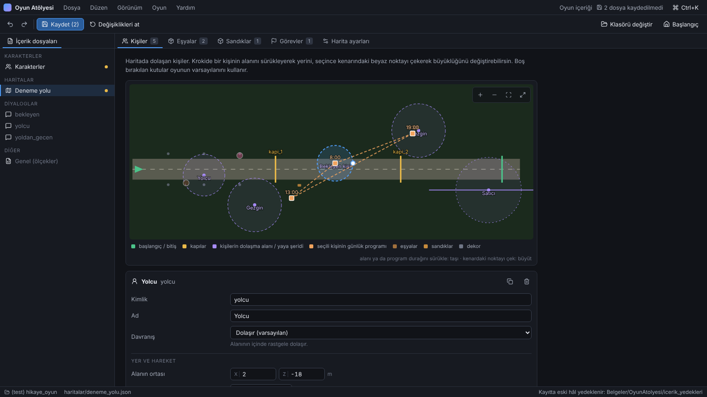
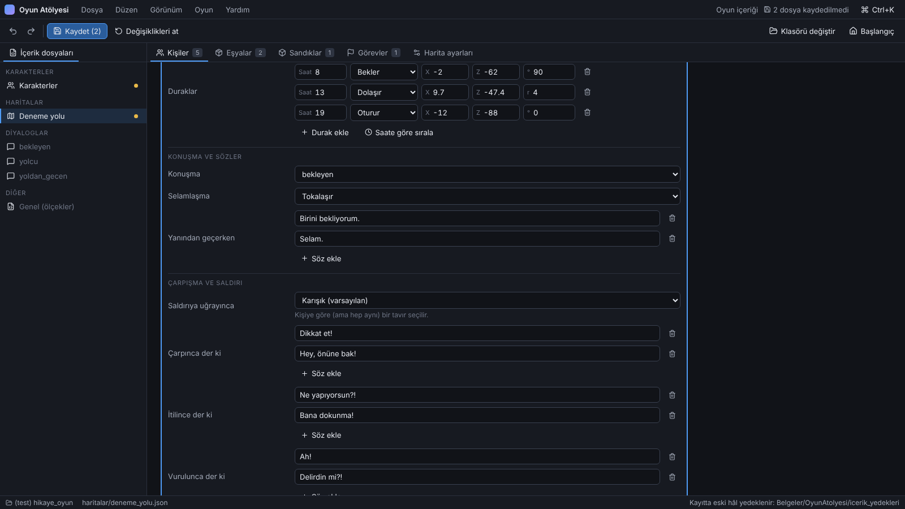
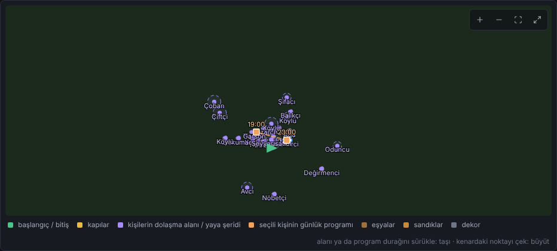

**Küçük kararlar (ben seçtim)**
- Yeni durak, son durağın 2 saat sonrasına ve aynı yere konuyor; "bekler" işiyle başlıyor.
- Karakterler'deki "Kişilerin bedenleri" sekmesinin adı **"Kişiler (beden ve can)"** oldu.

### Haftalık inceleme — 16–22 Kasım haftası
**Bu hafta neler eklendi**
- **Oyun Atölyesi** (v0.4 → v0.7): oyunun içerik dosyalarını açıp düzenleyen **Oyun içeriği** ekranı (16 Kasım); haritada **kişiler**
  (kroki üzerinde alan, şerit; davranış, sözler, saldırı tavrı, kalabalık — 17 Kasım); **sandıklar ve görevler** (20 Kasım);
  **günlük program, gün-gece, can** ve yakınlaşan kroki (bu gece). Her biri oyunun o hafta eklediği yeni alanlara göre yapıldı.
- **Yankı** (yeni!): telefonda oynanan yarasa oyunu sıfırdan kuruldu (19 Kasım), bilgisayarda çift tıklanan **Yanki.html**,
  geniş ekrana tam sığma ve mağaranın akarak belirmesi (21 Kasım, senin geri bildirimin).
- Gece çalışması artık tek sohbette, geceler sırayla Atölye / Yankı.

**Bu hafta denemeni önerdiğim 5 şey**
1. **Bir köylünün günü:** Atölye → Köy meydanı → bir kişinin programına yeni bir durak ekle (ör. 12:00 kuyunun başında bekle) → Kaydet → oyunda saati ilerlet.
2. **Sandık + görev:** Sandıklar'da bir sandık ekle, içine bir eşya koy; Görevler'de "Köy bilgesiyle konuş → sandığı aç" görevi kur; oyunda bitir.
3. **Bir kişinin canı:** Demirci'nin canını 200 yap (kişiye özel), oyunda dövüşte farkı gör; sonra kutuyu boşaltıp ortak değere döndür.
4. **Yankı bilgisayarda:** `oyun_atolyesi\yanki\Yanki.html`'e çift tıkla, F11 ile tam ekran; rekorunu yaz.
5. **Yankı telefonda:** GitHub'da Settings → Pages → main → Save (bir kerelik), sonra telefondan https://harunyetkin.github.io/oyun_atolyesi/yanki/oyun/ → ana ekrana ekle.

**Tasarım ve yön için sorular** (cevabını gece çalışmasının sohbetine yazman yeterli)
- **Atölye'de sıradaki büyük adım:** (A) iç mekânlar, geçişler ve meşaleler (köyün kalanı), (B) **konuşma ağacı düzenleyicisi** (diyaloglar şimdi
  yalnız okunuyor), (C) 3D harita görünümü. Ben (A)'yı sıraya koydum.
- **Kroki mi, 3D mi?** Köy büyüdükçe kroki yetmeyebilir: (A) krokiyi geliştirmeye devam (zemin ve binaların ana hatlarını çizmek), (B) doğrudan 3D görünüme geçmek.
- **Yankı'nın yönü:** (A) soldan sağa (şimdiki), (B) aşağıdan yukarı. Ve Mor → Buz → Lav bölümleri ile yol ayrımları uygun mu?

**Gelecek haftanın planı**
- Atölye: iç mekânlar ve geçişler, meşaleler, zeminler ve görünmez duvarlar; ardından `arayuz.json` (menü görünüşü) ve oturaklar.
- Yankı: duraklat düğmesi, sarkıt ve dikitler, örümcek ağı / su damlası gibi ölümcül olmayan tehlikeler.

**Kısa ekran görüntüsü serisi**

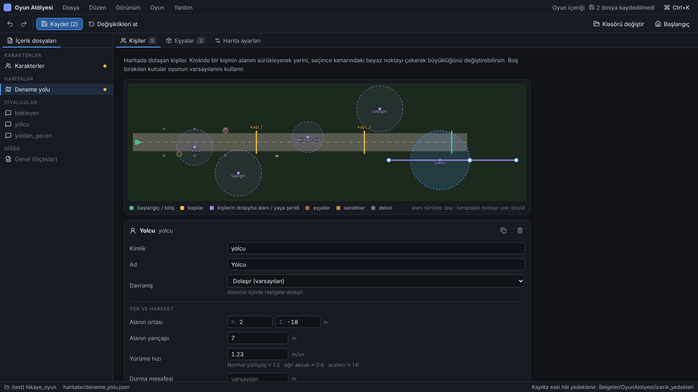
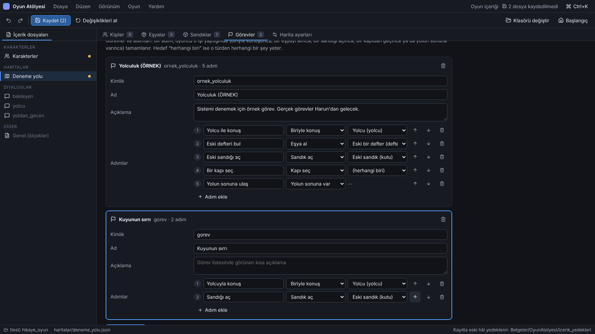

**Sıradaki adım**
- Atölye'nin sıradaki gecesinde: iç mekânlar ve geçişler.

## 2026-11-20 (gece) — Sandıklar ve görevler artık Atölye'de
**Bu gece yapılanlar**
- Haritanın üstünde iki yeni sekme var: **Sandıklar** ve **Görevler**.
- **Sandıklar:** Krokide sandıklar turuncu kutular; **sürükleyerek yerlerini değiştirebiliyorsun**. Her sandığın kartında adı, yeri, açısı ve
  **içindeki eşya** var: eşyanın adı, çantada görünen açıklaması, açınca ekranda çıkan mesaj ve **puanları**. İstersen Unreal'deki
  görünüşünü de (gövde/kapak modeli, kapağın nereden ve ne kadar açılacağı) ayarlayabiliyorsun; boş bırakırsan oyunun hazır sandığı kullanılır.
- **Görevler:** Her görevin adı, açıklaması ve **adımları** var. Bir adım şöyle yazılıyor: *"Kuyu bilgesiyle konuş"* + tür (**Biriyle konuş /
  Eşya al / Sandık aç / Kapı seç / Yolun sonuna var**) + hedef. Hedef listesi haritadan geliyor: kişiler, eşyalar, sandıklar, kapılar;
  "herhangi biri" de seçilebiliyor. Adımların sırasını ↑ ↓ ile değiştirebiliyorsun.
- Bir kişinin, eşyanın ya da sandığın kimliğini değiştirirsen görev adımları da **kendiliğinden** yeni kimliğe geçiyor.
- Yazısı boş adım ya da haritada artık olmayan bir hedef (ör. silinmiş sandık) sarı **Dikkat** kutusunda görünüyor.
- Oyunun yeni ana haritası **Köy meydanı** ile denedim. Bitiş çizgisi 500 m ileride olduğu için kroki çok ince bir şeride dönüşüyordu;
  artık kroki haritadaki şeylere göre boyutlanıyor ve uzak bitiş "bitiş … m ileride →" diye gösteriliyor.
- Testler: 39 birim testi + Chrome'da 105 otomatik kontrol (13'ü bu gece eklendi) ve dosya işleri testi; hepsi geçiyor.

**Nasıl denenir**
1. GitHub Desktop: **Fetch origin → Pull origin** (`oyun_atolyesi` ve `hikaye_oyun`), sonra `exe_yap.bat`, sonra `OyunAtolyesi.exe`.
2. **Oyun içeriğini aç → Köy meydanı → Sandıklar → + Sandık ekle.** Krokide sandığı Köy bilgesinin yanına sürükle, içindeki eşyaya
   bir ad ver (ör. "Eski anahtar"), **Kaydet**. Unreal'de oyunu başlat: sandık o yerde olmalı, açınca eşya çantaya girmeli.
3. **Görevler → + Görev ekle.** Birinci adım: "Köy bilgesiyle konuş" / Biriyle konuş / Köy bilgesi. **+ Adım ekle**: "Sandığı aç" / Sandık aç /
   yeni sandık. **Kaydet**. Oyunda görev listesinde bu iki adım görünmeli ve yaptıkça işaretlenmeli.

**Ekran görüntüleri**
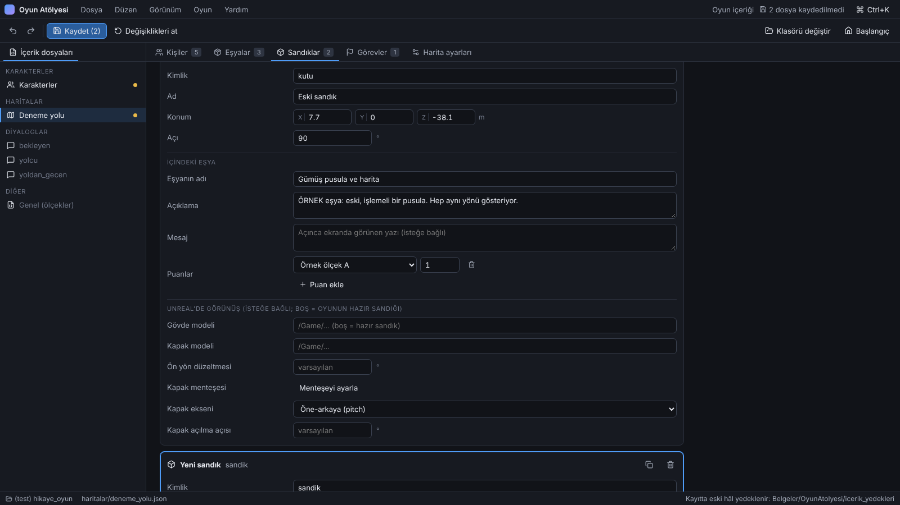

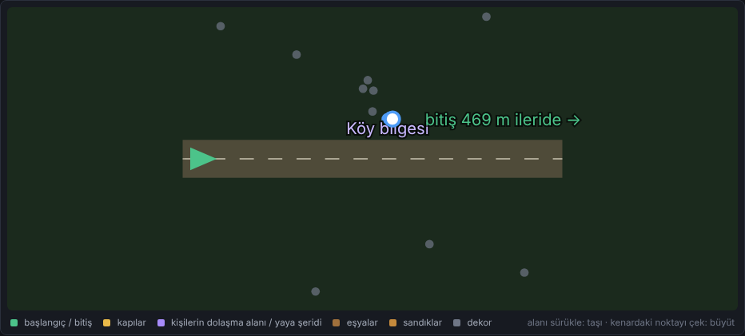

**Küçük kararlar (ben seçtim, istersen değiştiririz)**
- Görevleri (A) seçeneğindeki gibi her haritanın içinde, basit adım listesi olarak yaptım (sorduğum soruya cevap gelmediği için).
- Yeni sandık yolun sol kenarına konuyor (eşyalar sağ kenara konuyordu); karışmasınlar diye.

**Senin kararın gereken konular**
- Oyuna son günlerde çok şey eklendi (kişilerin günlük programı, gün-gece saati, iç mekânlar ve geçişler, menü görünüşü `arayuz.json`…).
  Sırayı ben şöyle koydum: **(1)** kişi programı + gün-gece ve ortam ayarları, **(2)** iç mekânlar/geçişler, **(3)** menü görünüşü.
  Önce görmek istediğin başka bir şey varsa bu sohbete yazman yeterli.

**Sıradaki adım**
- Atölye'nin sıradaki gecesinde: kişilerin günlük programı ve gün-gece/ortam ayarları.

## 2026-11-17 (gece) — Haritadaki kişiler artık Atölye'de düzenleniyor
**Bu gece yapılanlar**
- Bir haritayı açınca artık ilk **Kişiler** sekmesi geliyor. Oyunun son günlerde kişilere eklediği her şey burada:
  - **Krokide** her kişinin dolaşma alanı mor bir daire. **Daireyi sürükleyerek** kişinin yerini değiştiriyorsun; kişiyi seçince
    dairenin kenarında **beyaz bir nokta** çıkıyor, onu çekerek alanı büyütüp küçültüyorsun.
  - **Davranış:** dolaşır / yerinde bekler / bankta oturur / **yolda yürür**. "Yolda yürür" seçince krokide kişinin yaya şeridi
    (düz mor çizgi) çıkıyor; uçlarını çekerek şeridi uzatıp kısaltabiliyorsun.
  - **Yürüme hızı** (oyunun sınırı 3 m/sn; daha büyüğünü yazarsan 3'e iniyor), **durma mesafesi** (oyuncu ne kadar yaklaşınca durup döner).
  - **Konuşma** (hangi diyalog dosyası; listeden seçiliyor), **selamlaşma** (tokalaşır / el sallar / yok), **yanından geçerken** söylediği sözler.
  - **Saldırıya uğrayınca:** kaçar / savunur / karşılık verir / karışık. Ve **çarpınca, itilince, vurulunca** söylediği sözler.
  - **Beden (MetaHuman)** yolu. Eski Godot görünümü yalnız özet olarak duruyor (Unreal okumuyor).
  - Kişi **ekle / çoğalt / sil**. Bir kişinin kimliğini değiştirirsen görevdeki "… ile konuş" adımı ve Karakterler'deki beden kaydı da kendiliğinden yeni kimliğe geçiyor.
- Aynı sekmede **Kalabalık** kartı: otomatik üretilen MetaHuman'lardan kaç kişinin yolda dolaşacağı, hangi klasörden, ne konuşacakları.
- Küçük eklemeler: eşyalara **açıklama** (çantada görünen), Harita ayarlarında **güneşin yavaşça alçalması** ve yeni **Sesler** kartı
  (adım, rüzgâr, kuş, darbe sesleri ve şiddetleri); oyuncunun animasyon listesinde oturma, itme, darbe alma, yere düşme, yerden kalkma adları.
- Testler: 37 birim testi + Chrome'da 94 otomatik kontrol (20'si bu gece eklendi) ve dosya işleri testi; hepsi geçiyor.

**Nasıl denenir**
1. GitHub Desktop: **Fetch origin → Pull origin** (`oyun_atolyesi` ve `hikaye_oyun`), sonra `exe_yap.bat`, sonra `OyunAtolyesi.exe`.
2. **Oyun içeriğini aç → Deneme yolu**. Kişiler sekmesi açılır; krokide "Yolcu"nun dairesini biraz ileri sürükle.
3. Yolcu'nun kartında **Saldırıya uğrayınca → Kaçar** seç, **Yanından geçerken**'e yeni bir söz ekle (ör. "Yolun açık olsun!"). **Kaydet**.
4. Unreal'de oyunu başlat: Yolcu yeni yerinde dolaşmalı, yanından geçince yeni sözü söyleyebilmeli, ona vurunca kaçmalı.
5. İstersen bir kişiyi **Yolda yürür** yap ve krokide şeridin uçlarını çek; oyunda o çizgi boyunca ileri geri yürümeli.

**Ekran görüntüleri**

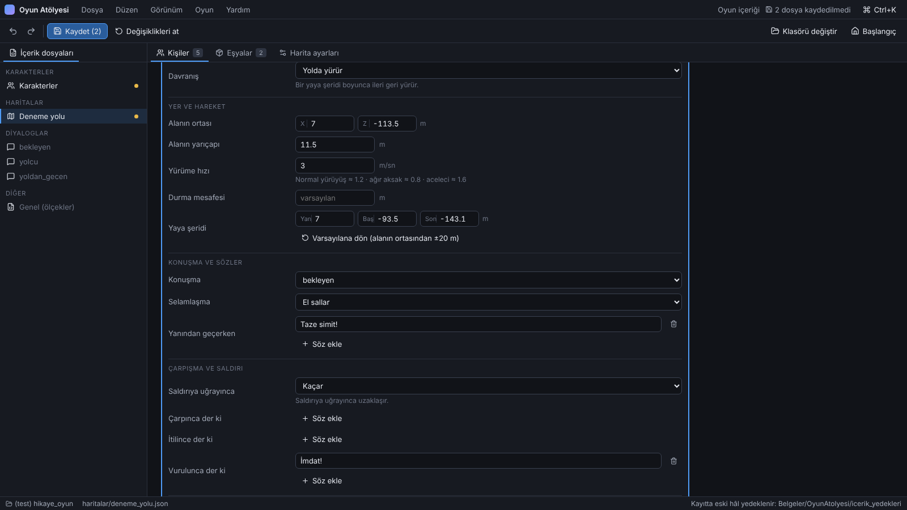

**Küçük kararlar (ben seçtim, istersen değiştiririz)**
- Harita açılınca ilk **Kişiler** sekmesi geliyor (en çok değişen kısım bu olduğu için).
- Yaya şeridi oyunda Unreal ölçüsüyle (cm) yazılıyor; ekranda ise diğer konumlar gibi **metre** (yan / baş / son) gösteriliyor.
- Kişinin görünüşü (eski Godot kıyafet/yaş alanları) düzenlenmiyor; Unreal'de beden MetaHuman olduğu için yalnız **beden yolu** düzenleniyor.

**Senin kararın gereken konular**
- Sırada **sandıklar ve görevler** var. Görevleri nasıl düzenlemek istersin? **(A)** Basit liste: her adım bir satır ("Yolcu ile konuş" + tür + hedef),
  ya da **(B)** görevleri haritadan bağımsız, ayrı bir "Görevler" ekranında toplamak. Bir şey demezsen (A)'yı yapacağım.

**Sıradaki adım**
- Sandıklar (kart + krokide sürükleme) ve görevler; sonra oturaklar, ana menüdeki karakter seçimi ve model çarpışmaları.

## 2026-11-16 (gece) — Oyununun içeriği artık Atölye'de düzenlenebiliyor
**Bu gece yapılanlar**
- Başlangıç ekranına yeni bir düğme geldi: **Oyun içeriğini aç**. Bu, 3D hikâye oyununun (hikaye_oyun)
  dosyalarını açan yepyeni bir ekran. İlk seferde senden oyunun klasörünü seçmeni istiyor (GitHub Desktop'un
  indirdiği `hikaye_oyun` klasörü); sonra hatırlıyor.
- **Karakterler → Oyuncu:** Oyuncunun bütün ayarları kartlar halinde: MetaHuman bedeni ve animasyon yolları,
  **Kontrol biçimi** (yeni "Kameraya göre yürü" anahtarı ve dönüş hızı/çevikliği/ivmesi), hareket hızları, kaçınma,
  kamera, dövüş, doğallık (beden dili), etkileşim anları, çanta ve bütün animasyon yolları. Her sayının yanında birimi
  (cm/sn, °, sn) ve kısa bir açıklama var. Oyuna ileride yeni bir ayar eklersem, açıklamasını yazmasam bile ilgili kartta
  "yeni" rozetiyle görünür ve değiştirilebilir.
- **Karakterler → Kişilerin bedenleri:** Haritadaki her kişinin (Yolcu, Bekleyen kişi, Gezginler) MetaHuman bedenini
  seçtiğin yer. Haritada olup bedeni olmayan kişiler için hazır "+ ekle" düğmeleri çıkıyor.
- **Harita → Eşyalar:** Yerdeki alınabilir eşyalar (defter, çiçek…). Üstte haritanın **krokisi** var: yol, kapılar, kişilerin
  dolaşma alanları ve eşyalar üstten görünüyor; **bir eşyayı fareyle sürükleyerek yerini değiştirebiliyorsun**.
  Her eşyanın adı, rengi, mesajı, puanları (ölçek seç + sayı) ve isteğe bağlı "elde duruşu" düzenleniyor. Eşya ekle, çoğalt, sil.
- **Harita → Harita ayarları:** Unreal'deki model açı düzeltmesi, zemin ve yol malzeme klasörleri ve karo boyları,
  yolun boyu/genişliği/renkleri, ışık ve gökyüzü, başlangıç ve bitiş.
- Yanlış yazılan bir şey (ör. `/Game/` ile başlamayan bir Unreal yolu ya da Türkçe harfli bir kimlik) sarı uyarıyla gösteriliyor.
- **Güvenlik:** Hiçbir şey kendiliğinden kaydedilmiyor; **Kaydet** (Ctrl+S) değişen dosyaları birden yazıyor ve her kayıttan önce
  eski hâli `Belgeler\OyunAtolyesi\icerik_yedekleri` klasörüne kopyalıyor. Dosyada bu ekranda görünmeyen şeylere (ör. 83 dekor
  nesnesi) dokunulmuyor. Ctrl+Z / Ctrl+Y burada da çalışıyor. Kaydetmeden çıkmaya kalkarsan bir kez daha soruyor.
- Diyaloglar ve diğer dosyalar şimdilik yalnızca okunuyor (düzenleyicileri Aşama 4'te).
- Testler: 35 birim testi + Chrome'da 74 otomatik kontrol (27'si bu gece eklendi) ve dosya işleri testi; hepsi geçiyor.

**Nasıl denenir**
1. GitHub Desktop: **Fetch origin → Pull origin** (hem `oyun_atolyesi` hem `hikaye_oyun` için), sonra `exe_yap.bat`, sonra `OyunAtolyesi.exe`.
2. Başlangıç ekranında **Oyun içeriğini aç** → açılan pencerede `hikaye_oyun` klasörünü seç.
3. **Karakterler → Kontrol biçimi**'nde "Kameraya göre yürü" anahtarını kapat, **Kaydet**. Unreal'de oyunu başlat:
   A/D artık karakteri döndürmeli (eski biçim). Sonra anahtarı yeniden aç ve kaydet.
4. **Deneme yolu → Eşyalar**: krokide "Eski bir defter"i yolun öbür yanına sürükle, adını değiştir, **+ Puan ekle** de, kaydet.
   Oyunda defter yeni yerinde ve yeni adıyla ("[F] Al: …") görünmeli.
5. GitHub Desktop'ta `hikaye_oyun` deposunda yalnızca değiştirdiğin satırların değiştiğini görebilirsin.

**Ekran görüntüleri**

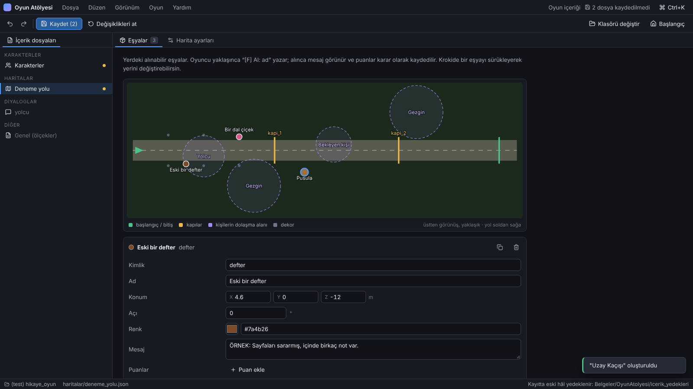
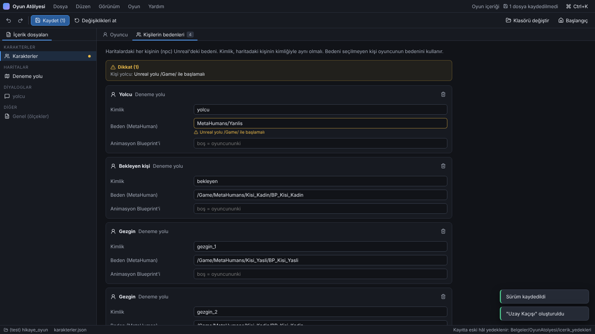

**Küçük kararlar (ben seçtim, istersen değiştiririz)**
- Oyun içeriği **otomatik kaydedilmiyor** (2D projelerden farklı): oyunun dosyalarına sen "Kaydet" demeden yazmak istemedim.
- Kroki **yaklaşık** bir üstten görünüş; yol soldan sağa ilerliyor. Gerçek 3D görünüm Aşama 2'de gelecek.
- Bir kutuyu boş bırakmak "oyunun varsayılanını kullan" demek (alan dosyadan silinir).
- Sayıların biçimi: dosyada `1.0` yazan bir değer kaydedince `1` olarak yazılıyor; oyun ikisini aynı okuyor.

**Senin kararın gereken konular**
- Sırada iki seçenek var, hangisini önce istersin?
  **(A)** Aynı ekranda kişilerin dolaşma alanlarını ve kapı seçimlerini krokiden düzenlemek (hızlı, hemen işe yarar), ya da
  **(B)** doğrudan 3D görünüme (Aşama 2) geçmek. Bir şey demezsen önce (A)'yı yapacağım.

**Sıradaki adım**
- Oyun içeriği ekranında kişiler (dolaşma alanı, hız, konuşma) ve kapı seçimleri.

## 2026-11-15 (gece) — Sahne düzenleyici tamam, geri al / yinele geldi (Aşama 1 bitti)
**Bu gece yapılanlar**
- **Geri al / yinele** artık çalışıyor: **Ctrl+Z** geri alır, **Ctrl+Y** yeniden yapar. Araç çubuğunun
  en solunda iki ok düğmesi de var. Bir nesneyi sürüklemek, bir kutuya bir kelime yazmak ya da ok tuşuna
  art arda basmak **tek adım** sayılıyor; yani tek Ctrl+Z ile hepsi geri geliyor. 200 adım geriye gidebilirsin.
  Bir sürümü geri yüklemek de geri alınabiliyor.
- **Tutamaçlar:** Bir nesne seçince köşelerdeki beyaz kareleri sürükleyerek **boyutlandırabiliyorsun**
  (karşı köşe yerinde kalır; Shift basılıysa oranı korunur). Üstteki yuvarlağı sürükleyerek
  **döndürebiliyorsun**; Döndür aracını seçmen gerekmiyor (Shift ile 15°'lik adımlar).
- **Çoklu seçim:** **Shift+tık** ile nesne ekle/çıkar, **boş bir yerden sürükleyerek kutu** çiz,
  **Ctrl+A** ile hepsini seç, **Esc** ile bırak. Seçili nesneleri birlikte taşıyabilir, silebilir,
  çoğaltabilirsin. Sol paneldeki sahne ağacında da Shift/Ctrl ile çoklu seçim var.
- **Ok tuşları:** seçili nesneleri 1 piksel, Shift ile 10 piksel kaydırır.
- **Hizalama:** Düzen menüsünde yeni **Hizala** bölümü ve sağ panelde **Hizala** kartı (8 düğme):
  sola/ortaya/sağa, üste/ortaya/alta hizala, yatay/dikey eşit dağıt. Tek nesne seçiliyse sahneye göre
  hizalar (ör. "Yatay ortala" nesneyi sahnenin tam ortasına koyar).
- Menülerdeki "Aşama 1" rozetleri kalktı. Böylece **Aşama 1 (Çekirdek) tamamlandı.**
- Testler: 25 birim testi + Chrome'da 47 otomatik kontrol (15'i bu gece eklendi), hepsi geçiyor.

**Nasıl denenir**
- GitHub Desktop: **Fetch origin → Pull origin**, sonra `exe_yap.bat`, sonra `OyunAtolyesi.exe`.
- "Örnek: Kanat Çırp"ı aç. Kuş'a tıkla, sağ alt köşedeki beyaz kareyi dışarı sürükle → kuş büyür.
  Üstteki yuvarlağı çevir → kuş döner. Sonra **Ctrl+Z**'ye iki kez bas → ikisi de geri gelir.
- Sahnenin dışındaki koyu alandan başlayıp bütün sahneyi kapsayan bir kutu çiz → her şey seçilir.
  **Delete** → hepsi silinir. **Ctrl+Z** → hepsi geri gelir.
- İki boruya Shift ile tıkla, sağdaki **Hizala** kartından "Üste hizala"yı dene.
- Bir nesne seçip ok tuşlarıyla (ve Shift+ok ile) oynat.

**Ekran görüntüleri**

**Küçük kararlar (ben seçtim, istersen değiştiririz)**
- Hizalama kısayolları **Alt+A/H/D** (sol/orta/sağ) ve **Alt+W/V/S** (üst/orta/alt). W/A/S/D yön tuşlarına benzesin diye seçtim.
- Birden fazla nesne seçiliyken sağ panel yalnızca "asıl seçili" (ilk tıkladığın, koyu mavi çerçeveli)
  nesnenin ayarlarını gösteriyor. Hepsinin ayarını birlikte değiştirmek gerekirse sonra eklerim.
- Kutu seçimi, kutuya **değen** nesneleri seçiyor (tamamen içinde olmasına gerek yok).
- Geri al geçmişi proje kapanınca sıfırlanıyor (kalıcı yedek için Sürümler var).

**Senin kararın gereken konular**
- Aşağıdaki haftalık incelemedeki sorulara bakabilirsin.

**Sıradaki adım**
- Aşama 2: aracın ortasına **3D Harita** sekmesi (three.js ile döndürülebilir 3D görünüm, ızgara zemin).

## Haftalık inceleme (9–15 Kasım 2026)
*(Bu inceleme Pazar gecesi çalışmasında yazıldı; İstanbul saatiyle gece yarısını biraz geçmişti.)*

**Bu hafta neler eklendi**
- **v0.1:** yarasa oyununa özel ilk ayar paneli (artık `eski_v01/` altında duruyor).
- **v0.2:** baştan yeni, modern arayüz — menüler, araç çubuğu, paneller, komut paleti (Ctrl+K),
  nesne türleri ve bileşenler (Görünüm, Fizik, Çarpışma, Işık, Davranışlar), sürümler, değişkenler.
- **Oyun motoru:** gerçek fizik, çarpışma, içinden geçilemeyen nesneler; 3 hazır davranış
  (tuşla zıpla, sabit hızla kay, ekrandan çıkınca yok ol); çarpışma alanlarını gösterme.
- **Yön kararı (senin):** araç, **3D hikâye oyununun içerik editörü** olacak; 2D hedefi ertelendi.
  Oyun bu hafta Unreal Engine'e geçti; içerik yine aynı JSON dosyalarında, yani araç için yol değişmedi.
- **Bu gece:** sahne düzenleyici tamamlandı ve geri al / yinele geldi → **Aşama 1 bitti.**

**Bu hafta denemen gereken 5 şey**
1. **Güncelle:** GitHub Desktop → Fetch origin → Pull origin → `exe_yap.bat` → `OyunAtolyesi.exe`.
2. **Geri al:** Örnek projede birkaç nesneyi sürükle, sil, rengini değiştir; sonra Ctrl+Z'ye art arda
   basıp her şeyin sırayla geri geldiğini gör, Ctrl+Y ile ileri al.
3. **Tutamaçlar:** Bir boruyu seç, köşesinden uzat, üstteki yuvarlakla eğ. Shift basılıyken tekrar dene.
4. **Çoklu seçim + hizalama:** Bulutları kutu ile seç (boş yerden sürükle), sağdaki Hizala kartından
   "Üste hizala" ve "Yatay eşit dağıt"ı dene.
5. **Oyna:** F5 ile oyunu başlat, Boşluk ile kuşu uçur; Görünüm → "Çarpışma alanlarını göster"i açıp tekrar oyna.

**Ekran görüntüsü serisi**

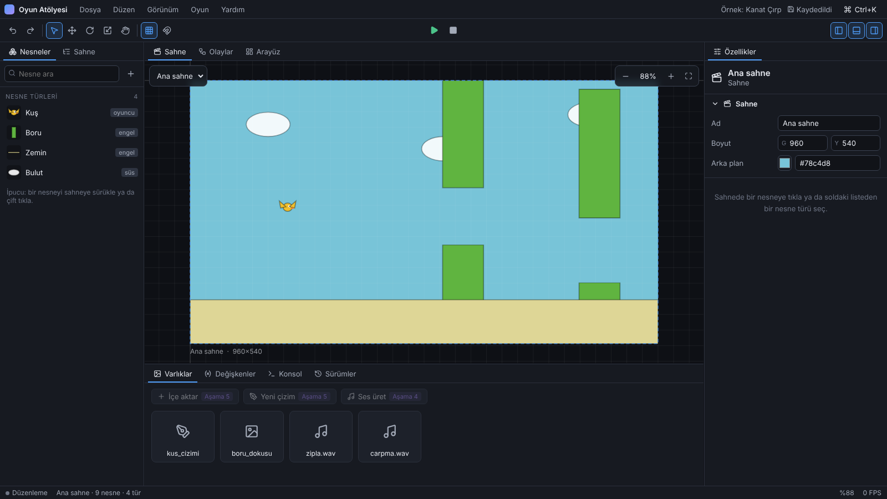
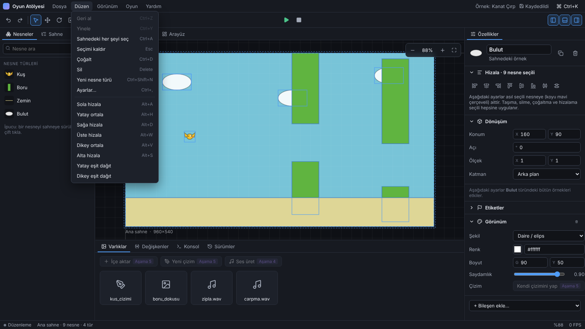
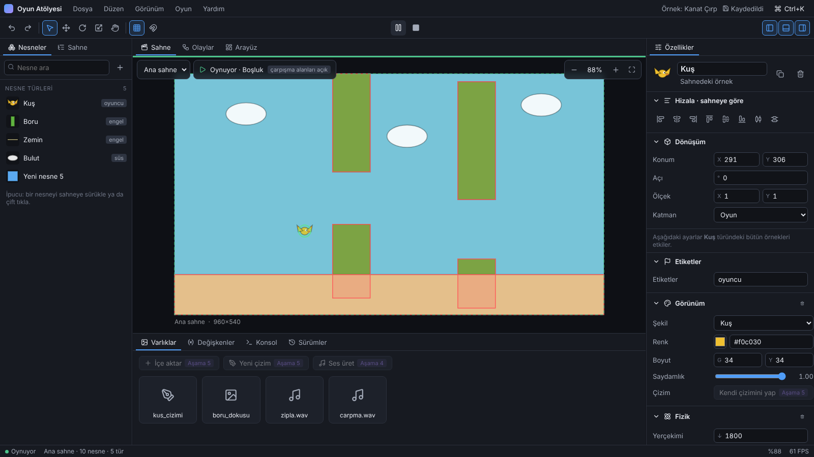
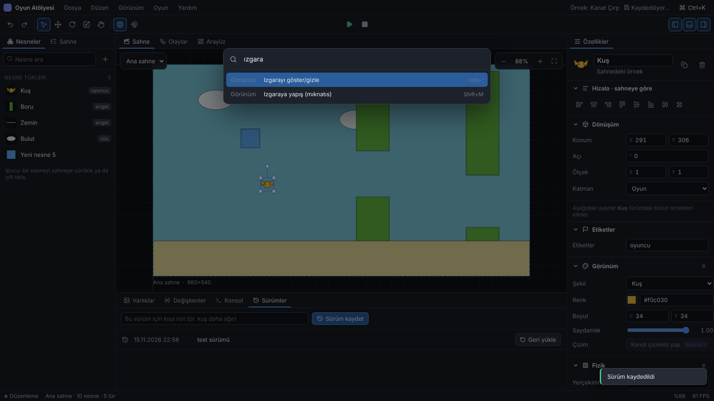

**Tasarım ve yön soruları** (birini seçmen yeterli; sohbette ya da GERI_BILDIRIM.md'ye yazabilirsin)
1. **3D görünüm nerede dursun?**
   a) Ortadaki sekmelere "3D Harita" diye yeni bir sekme (Sahne/Olaylar/Arayüz'ün yanına) — *benim önerim*
   b) 3D projeler açılınca 2D sahne tamamen 3D görünümle yer değiştirsin
   c) Ekran ikiye bölünsün: solda üstten 2D harita, sağda 3D görünüm
2. **3D'de kamera nasıl dönsün?**
   a) Unreal gibi: sağ tık basılıyken fareyle bak, W/A/S/D ile uç — *oyun Unreal'de olduğu için önerim*
   b) Blender/Godot gibi: orta tuşla bir noktanın etrafında dön
   c) İkisi de olsun, Ayarlar'dan seçilsin
3. **İlk hangi içerik editörü gelsin?** (3D görünüm hazır olunca)
   a) Harita: modelleri yerleştirme, ışık ve gökyüzü
   b) Karakter oluşturma ekranının seçenekleri (kaydırıcılar, sorular, puanlar)
   c) Konuşma ağacı (diyalog) düzenleyici
4. **Araç oyunun dosyalarına nasıl bağlansın?**
   a) Araçta "Oyun klasörünü seç" düğmesi; araç doğrudan oyunun `icerik/` klasörünü düzenler — *önerim*
   b) Araç kendi kopyasında çalışsın, "Oyuna gönder" deyince dosyaları oyuna kopyalasın

**Gelecek haftanın planı**
- 3D Harita sekmesi: döndürülebilir kamera, ızgara zemin, eksen göstergesi.
- glTF/GLB modelleri yükleyip gösterme; varlık listesinde 3D küçük resimler.
- 3D'de seçme ve taşı/döndür/ölçekle tutamaçları (bu gece yapılan geri al ve çoklu seçim altyapısı kullanılacak).
- Fırsat kalırsa: güneş yönü, gökyüzü rengi ve sis önizlemesi.

## 2026-11-14 (gece) — Oyun motoru: fizik, çarpışma ve hazır davranışlar
**Bu gece yapılanlar**
- ▶ Oynat artık gerçek bir **oyun motoru** çalıştırıyor (önceki "basit önizleme" gitti). Bu motor
  editörden ayrı; ileride dışa aktarılan oyunlar da aynısını kullanacak.
  - **Fizik:** yerçekimi, başlangıç hızı, en yüksek hız ve sürtünme ayarları gerçekten çalışıyor.
  - **Çarpışma:** nesnelerin daire ya da kutu biçimli çarpışma alanı var. "İçinden geçilemez"
    işaretli nesnelerin içinden geçilmiyor: örnekte kuş artık zeminin üstünde duruyor, borulara
    çarpınca itiliyor. (Çarpınca oyunun bitmesi gibi sonuçlar Aşama 2'deki olay kurallarıyla gelecek.)
  - Oyun her bilgisayarda aynı hızda ilerliyor (ekranın kare hızından bağımsız).
- **Hazır davranışlar** yenilendi ve ayarları gerçekten çalışıyor:
  - **Tuşla zıpla / uç:** tuşu seçebiliyorsun (Boşluk, ok tuşları, W/A/S/D, Enter, fare tıklaması).
  - **Sabit hızla kay:** hız ve artık **yön** de var (sola, sağa, yukarı, aşağı).
  - **Ekrandan çıkınca yok ol:** sahnenin dışına çıkan nesne silinir; sahnenin dışında doğan
    nesneler (ileride borular böyle doğacak) önce içeri girene kadar silinmez.
  - Yeni davranış eklemek artık tek dosyalık iş (benim için; sana fark etmez ama ileride hızlanır).
- **Görünüm > Çarpışma alanlarını göster** (Ctrl+Shift+C): kırmızı = içinden geçilemez,
  yeşil = değince haber verir ama geçilir. Ayarlar penceresinde de var.
- Oynarken üstteki şerit hangi tuşla oynandığını yazıyor ("Oynuyor · Boşluk").
- Oynarken W/E/R/H/V tuşları artık araç değiştirmiyor (oyun tuşu olabilecekleri için).
- Testler: 20 motor birim testi + Chrome'da 32 otomatik kontrol, hepsi geçiyor.

**Nasıl denenir**
- GitHub Desktop: **Fetch origin → Pull origin**, sonra `exe_yap.bat`, sonra `OyunAtolyesi.exe`.
- "Örnek: Kanat Çırp"ı aç, ▶ Oynat (F5). Kuş zemine düşüp durmalı; Boşluk'la uçmalı; borular sola kaymalı.
- Kuş'u seç → sağda Davranışlar → Tuş'u "Yukarı ok" yap, tekrar oynat: artık ok tuşuyla uçuyor.
- Görünüm menüsünden "Çarpışma alanlarını göster"i aç, oynat ve çerçeveleri gör.
- Boru'nun "Sabit hızla kay" yönünü "Sağa" yapmayı dene.

**Ekran görüntüleri**

**Küçük kararlar (ben seçtim, istersen değiştiririz)**
- Sürtünme 0–1 arası: her 0,1 saniyede yatay hızın bu oranı kaybolur (0,2 → 1 saniyede hız neredeyse biter).
- Döndürülmüş kutu biçimli nesnelerde çarpışma alanı, nesneyi saran düz bir kutu olarak hesaplanıyor.
  Eğik engeller için daha hassas çarpışma (çokgen) gerekirse sonra eklenir.

**Senin kararın gereken konular**
- Şimdilik yok.

**Sıradaki adım**
- Sahne düzenleyiciyi tamamlamak: köşelerden boyutlandırma, üstteki tutamaçtan döndürme, çoklu seçim,
  ok tuşlarıyla kaydırma, hizalama. Ardından geri al / yinele.

## 2026-11-14 (akşam) — v0.2: yeni arayüz
**Bugün yapılanlar** (Harun'la birlikte)
- Araç, genel amaçlı bir oyun yapım ortamı olacak şekilde **baştan kuruldu**. Yeni, modern arayüz:
  - **Başlangıç ekranı:** projelerin ve şablonlar.
  - **Üstte** menüler (Dosya, Düzen, Görünüm, Oyun, Yardım) ve araç çubuğu: seç, taşı, döndür,
    ölçekle, kaydır, ızgara, mıknatıs, ▶ oynat / ■ durdur, panelleri aç-kapa.
  - **Sol:** nesne türleri (sahneye sürükle-bırak) ve sahne ağacı (sahneler, katmanlar, nesneler).
  - **Orta:** sahne düzenleyici (yakınlaştırma, kaydırma, ızgara), olay kuralları sayfası
    (şimdilik okunur önizleme) ve arayüz düzenleyici (yakında).
  - **Sağ:** özellikler. Nesnelere "bileşen" ekleniyor: Görünüm, Fizik, Çarpışma, Işık, Davranışlar.
  - **Alt:** varlıklar, değişkenler, konsol, sürümler.
  - **Ctrl+K** komut paleti, **F1** kısayollar, ayarlar penceresi.
- ▶ ile basit bir önizleme çalışıyor (yerçekimi, zıplama, kayma). Çarpışma ve kurallar sonraki işler.
- Eski projelerin (Karanlık Mağara gibi) açılınca yeni biçime dönüştürülüyor.
- Bir oyun aracında olması gereken bütün özelliklerin listesi: **OZELLIKLER.md**.
- Otomatik test: arayüzün tamamını Chrome'da kullanan 20 kontrol + birim testleri, hepsi geçiyor.

**Nasıl denenir**
- GitHub Desktop: **Fetch origin → Pull origin**, sonra `exe_yap.bat`, sonra `OyunAtolyesi.exe`.
- "Örnek: Kanat Çırp" projesini aç, nesnelere tıkla, sürükle, sağdan ayarlarla oyna, ▶ ile dene.

**Ekran görüntüleri**

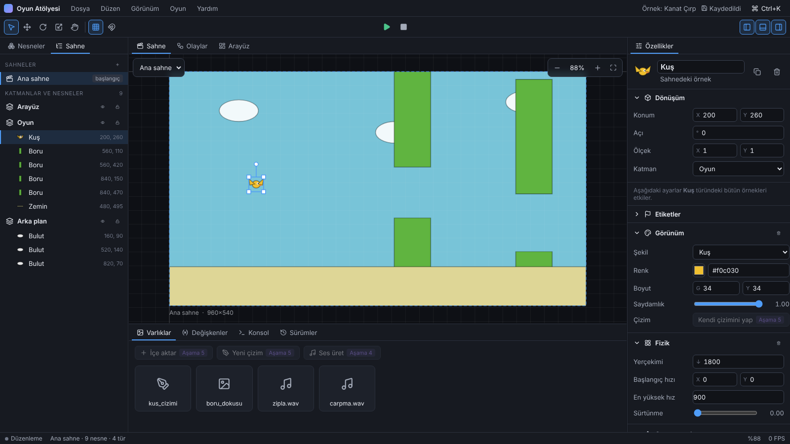

**Sıradaki adım**
- Gece çalışması: motor çekirdeği (fizik + çarpışma), ardından hazır davranışlar.

## 2026-11-14 — v0.1
**Bugün yapılanlar**
- Oyun Atölyesi'nin ilk sürümü hazır. Uygulama penceresinde:
  - **Sol:** Dünya, Oyuncu ve nesnelerin listesi; "+ Engel", "+ Tehlike", "+ Toplanabilir" ile ekleme.
  - **Orta:** Canlı oyun önizlemesi (Oyna, Duraklat, Baştan, ölümsüz Test modu).
  - **Sağ:** Seçili şeyin bütün ayarları: kaydırıcılar, renk seçiciler, açılır menüler.
    Değiştirdiğin anda oyun da değişir.
  - **Alt:** Sürüm kaydetme ve eski sürüme geri dönme.
  - **Üst:** Proje seçme, yeni proje (şablondan), oyunu dışa aktarma, klasörü açma.
- Nesnelerin dokununca yapabileceği 7 etki: oyunu bitirir, yavaşlatır, ağırlaştırır,
  kanadı zayıflatır, sersemletir, puan verir, kalkan verir.
- İki örnek proje: **Karanlık Mağara** (Yankı benzeri) ve **Kuş Uçuşu**.
- Değişiklikler otomatik kaydediliyor (Belgeler\OyunAtolyesi).

**Nasıl denenir**
- README'deki "İlk kurulum" adımlarıyla `exe_yap.bat` → `OyunAtolyesi.exe`.

**Ekran görüntüleri**

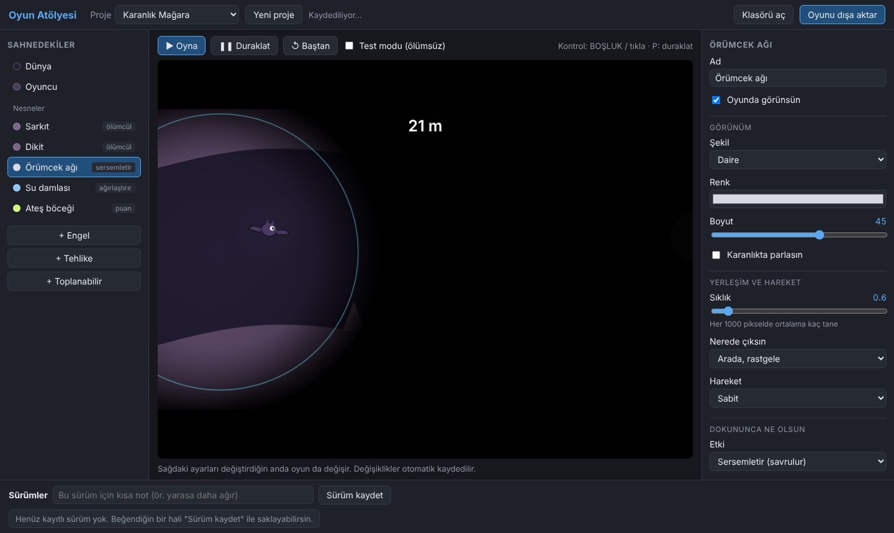

**Senin kararın gereken konular**
- Sıradaki büyük adım için tercihin: kendi şekillerini çizebileceğin bir çizim editörü mü,
  yoksa enerji/özel yetenek/bölüm gibi oyun kuralları mı?

**Sıradaki adım**
- Senin ilk kullanım yorumların, ardından YAPILACAKLAR'daki ilk işler.
