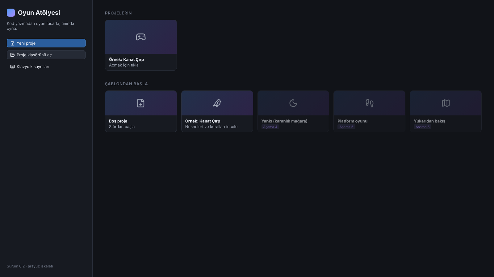
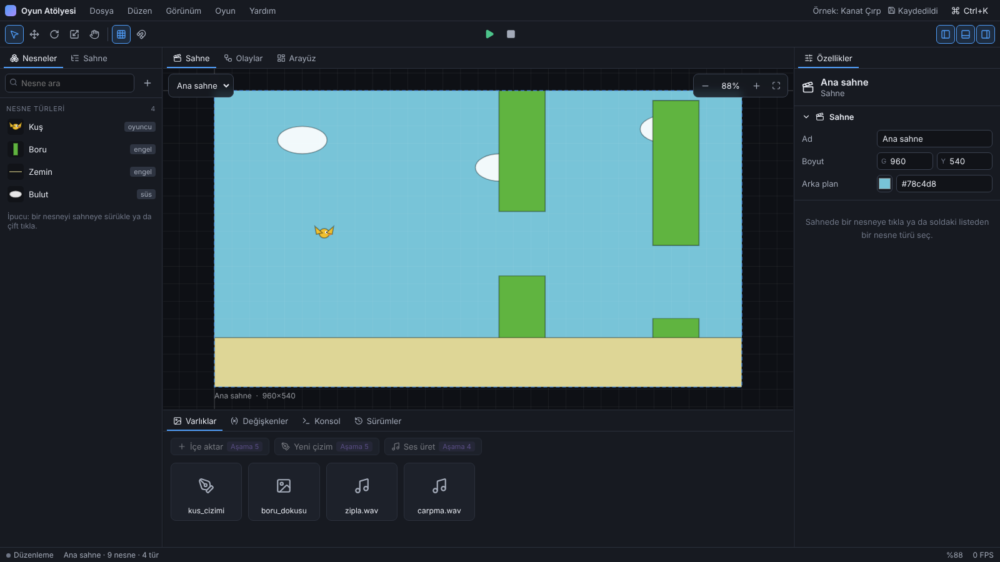
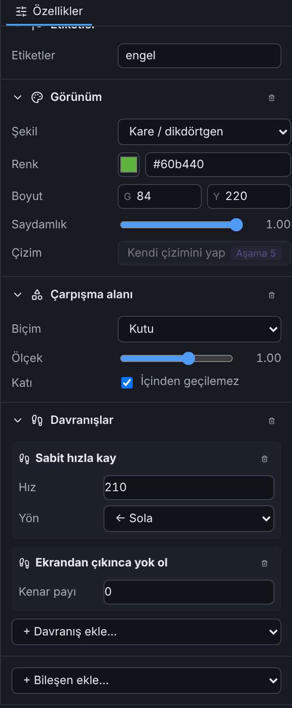
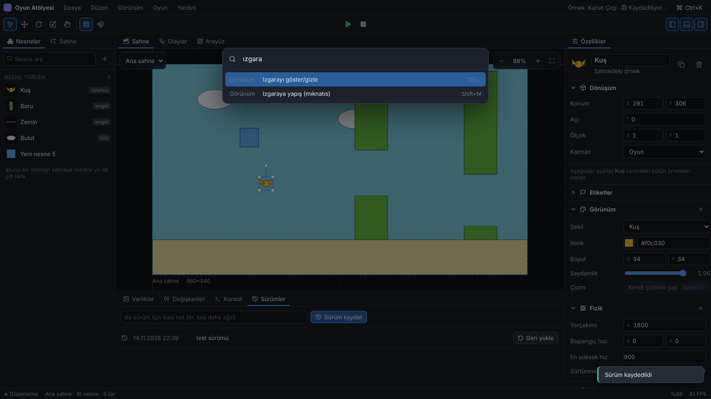
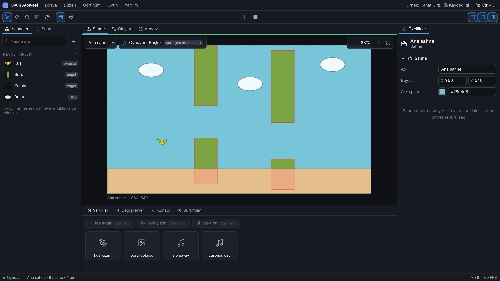

# Oyun Atölyesi — Kullanım Kılavuzu

Bu kılavuz, Oyun Atölyesi'ndeki **her ekranı, her düğmeyi ve her menüyü** ve aracın
**hangi adımlarla geliştirildiğini** anlatır. Claude her çalışmada kılavuzu günceller.
Yeni bir düğme eklenince, değişince ya da bir özellik "yakında" olmaktan çıkınca burası da değişir.

> Son güncelleme: 2026-11-15 · Araç sürümü: 0.2 (Aşama 1 — Çekirdek, devam ediyor)

**İçindekiler**
1. [Temel kavramlar](#1-temel-kavramlar)
2. [Başlangıç ekranı](#2-başlangıç-ekranı)
3. [Editör ekranının bölümleri](#3-editör-ekranının-bölümleri)
4. [Menü çubuğu](#4-menü-çubuğu)
5. [Araç çubuğu](#5-araç-çubuğu)
6. [Sol panel: Nesneler ve Sahne](#6-sol-panel-nesneler-ve-sahne)
7. [Orta alan: Sahne, Olaylar, Arayüz](#7-orta-alan-sahne-olaylar-arayüz)
8. [Sağ panel: Özellikler](#8-sağ-panel-özellikler)
9. [Hazır davranışlar](#9-hazır-davranışlar)
10. [Alt panel: Varlıklar, Değişkenler, Konsol, Sürümler](#10-alt-panel-varlıklar-değişkenler-konsol-sürümler)
11. [Durum çubuğu](#11-durum-çubuğu)
12. [Pencereler](#12-pencereler)
13. [Oyunu oynatmak](#13-oyunu-oynatmak)
14. [Klavye kısayolları](#14-klavye-kısayolları)
15. [Adım adım: ilk oyununu kur](#15-adım-adım-ilk-oyununu-kur)
16. [Geliştirme adımları (sürüm geçmişi)](#16-geliştirme-adımları-sürüm-geçmişi)

Rozetler: <kbd>Aşama N</kbd> yazan, soluk görünen bir düğme henüz çalışmaz; o aşamada gelecektir.

---

## 1. Temel kavramlar

| Kavram | Anlamı |
|---|---|
| **Proje** | Bir oyunun tamamı. Belgeler\OyunAtolyesi klasöründe saklanır, otomatik kaydedilir. |
| **Sahne** | Oyunun bir ekranı (ör. ana oyun, menü, bitiş). Bir projede birden fazla olabilir. |
| **Nesne türü** | Bir nesnenin tarifi: neye benzediği, nasıl hareket ettiği (ör. "Boru"). |
| **Örnek** | Sahneye yerleştirilmiş bir nesne türü. Aynı türden çok örnek olabilir; türü değiştirince hepsi değişir. |
| **Bileşen** | Nesne türüne eklenen yetenek: Görünüm, Fizik, Çarpışma alanı, Işık kaynağı, Davranışlar. |
| **Davranış** | Hazır hareket kalıbı: "Tuşla zıpla", "Sabit hızla kay" gibi. |
| **Katman** | Sahnedeki çizim sırası: Arka plan → Oyun → Arayüz (üstteki önde görünür). |
| **Etiket** | Nesneleri gruplamak için ad ("engel", "oyuncu"). Kurallarda kullanılacak (Aşama 2). |
| **Olay kuralı** | "Şu olunca → bunu yap" satırı (Aşama 2'de düzenlenebilir olacak). |
| **Değişken** | Skor, can gibi oyun sırasında değişen sayı/yazı. |
| **Sürüm** | Projenin notlu bir yedeği; istediğinde geri dönebilirsin. |

## 2. Başlangıç ekranı

Uygulama açılınca gelir.
- **Projelerin:** kayıtlı projelerin kartları. Bir karta tıkla → proje editörde açılır.
- **Yeni proje:** Yeni proje penceresini açar (ad yaz, boş ya da şablondan başla).
- **Proje klasörünü aç:** projelerin saklandığı klasörü Windows Gezgini'nde açar.
- İlk açılışta "Örnek: Kanat Çırp" projesi kendiliğinden oluşturulur.
- Eski (v0.1) projeler açılınca yeni biçime otomatik dönüştürülür; konsola bir not düşülür.

## 3. Editör ekranının bölümleri

| Yer | Ne var |
|---|---|
| En üst | **Menü çubuğu** (Dosya, Düzen, Görünüm, Oyun, Yardım), proje adı, kayıt durumu, Ctrl+K düğmesi |
| Üstün altı | **Araç çubuğu**: araçlar, ızgara, mıknatıs, oynat/duraklat/durdur, panel düğmeleri |
| Sol | **Nesneler** ve **Sahne** (ağaç) sekmeleri |
| Orta | **Sahne**, **Olaylar**, **Arayüz** sekmeleri |
| Sağ | **Özellikler**: seçili şeyin bütün ayarları |
| Alt | **Varlıklar**, **Değişkenler**, **Konsol**, **Sürümler** |
| En alt | **Durum çubuğu** |

Paneller arasındaki ince çizgileri sürükleyerek panelleri genişletip daraltabilirsin. Düzen hatırlanır.

## 4. Menü çubuğu

Menüdeki her komut **komut paletinde** (Ctrl+K) de aranabilir.

**Dosya**
| Komut | Kısayol | Ne yapar |
|---|---|---|
| Yeni proje… | Ctrl+N | Yeni proje penceresi |
| Proje aç… | Ctrl+O | Başlangıç ekranına döner, oradan proje seçilir |
| Kaydet | Ctrl+S | Hemen kaydeder (normalde zaten otomatik kaydedilir) |
| Sürüm kaydet… | Ctrl+Shift+S | Alt paneldeki Sürümler sekmesini açar, not kutusuna götürür |
| Proje ayarları… | — | Oyun adı, ekran boyutu, başlangıç sahnesi |
| Proje klasörünü aç | — | Projelerin klasörünü açar |
| Dışa aktar: HTML oyun | — | <kbd>Aşama 5</kbd> |
| Dışa aktar: Windows .exe | — | <kbd>Aşama 5</kbd> |

**Düzen**
| Komut | Kısayol | Ne yapar |
|---|---|---|
| Geri al / Yinele | Ctrl+Z / Ctrl+Y | <kbd>Aşama 1</kbd> — sıradaki işlerden |
| Çoğalt | Ctrl+D | Seçili örneği ya da nesne türünü kopyalar |
| Sil | Delete | Seçili örneği siler; nesne türü seçiliyse türü ve bütün örneklerini siler |
| Yeni nesne türü | Ctrl+Shift+N | Listeye yeni bir mavi kare ekler |
| Ayarlar… | Ctrl+, | Ayarlar penceresi |

**Görünüm**
| Komut | Kısayol | Ne yapar |
|---|---|---|
| Komut paleti | Ctrl+K | Bütün komutları arayıp çalıştırma kutusu |
| Sol / Sağ / Alt paneli göster-gizle | Ctrl+B / Ctrl+Alt+B / Ctrl+J | Panelleri açar-kapar |
| Izgarayı göster/gizle | Ctrl+' | Sahnedeki kareli çizgiler |
| Çarpışma alanlarını göster/gizle | Ctrl+Shift+C | Nesnelerin çarpışma sınırlarını çizer (kırmızı = içinden geçilmez, yeşil = geçilir) |
| Izgaraya yapış (mıknatıs) | Shift+M | Sürüklenen nesneler ızgaraya hizalanır |
| Yakınlaştır / Uzaklaştır | Ctrl++ / Ctrl+- | Sahne yakınlaştırma |
| Sahneyi ekrana sığdır | Ctrl+0 | Bütün sahneyi görünür yapar |
| Sahne / Olay kuralları / Arayüz düzenleyici | Ctrl+1 / 2 / 3 | Orta sekmeler arası geçiş |
| Araç: Seç / Taşı / Döndür / Ölçekle / Kaydır | V / W / E / R / H | Araç seçimi (oynarken çalışmaz, o tuşlar oyuna gider) |

**Oyun**
| Komut | Kısayol | Ne yapar |
|---|---|---|
| Oynat | F5 | Sahneyi oynatır |
| Duraklat / devam | F6 | Oyunu dondurur / sürdürür |
| Durdur | Shift+F5 | Oyunu bitirip düzenlemeye döner (oyun projeyi değiştirmez) |
| Ölümsüz test modu | — | <kbd>Aşama 2</kbd> |

**Yardım:** Klavye kısayolları (F1), Oyun Atölyesi hakkında.

**Sağ üst köşe:** proje adı · kayıt durumu (Kaydediliyor… / Kaydedildi / Kaydedilemedi) · **Ctrl+K** düğmesi (komut paleti).

## 5. Araç çubuğu

Soldan sağa:
| Düğme | Ne yapar |
|---|---|
| 🖱 Seç (V) | Nesneye tıklayıp seçer, sürükleyerek taşır |
| ✥ Taşı (W) | Sürükleyerek taşır |
| ↻ Döndür (E) | Nesneyi tutup çevirerek döndürür; Shift ile 15°'lik adımlar |
| ⤢ Ölçekle (R) | Nesneyi tutup merkezden uzaklaştırarak büyütür/küçültür |
| ✋ Kaydır (H) | Sahne görüntüsünü kaydırır (Boşluk basılı tutup sürüklemek ya da orta fare tuşu da aynı işi yapar) |
| ▦ Izgara | Izgarayı aç/kapa |
| 🧲 Mıknatıs | Izgaraya yapışmayı aç/kapa |
| ▶ Oynat (ortada) | Oyunu başlatır; duraklatılmışsa sürdürür |
| ⏸ Duraklat | Oynarken ▶ yerine görünür |
| ■ Durdur | Oyunu bitirir |
| Sağdaki üç panel simgesi | Sol, alt ve sağ paneli açar/kapar |

Aktif olan düğme mavi çerçeveli görünür. Üstüne gelince adı ve kısayolu yazar.

## 6. Sol panel: Nesneler ve Sahne

**Nesneler sekmesi**
- **Nesne ara** kutusu: ada ya da etikete göre süzer.
- **+** düğmesi: yeni nesne türü.
- Listedeki satır: küçük resim, ad ve ilk etiket. **Tıkla** → türün ayarları sağda açılır.
  **Sahneye sürükle** ya da **çift tıkla** → sahneye bir örnek eklenir.

**Sahne sekmesi (ağaç)**
- **Sahneler** listesi ve yanındaki **+** (yeni sahne). "başlangıç" rozeti oyunun açıldığı sahneyi gösterir.
- **Katmanlar ve nesneler:** her katmanın yanında 👁 (gizle/göster) ve 🔒 (kilitle: o katmandaki
  nesneler tıklanıp taşınamaz). Altında o katmandaki örnekler ve konumları; tıklayınca seçilir.

## 7. Orta alan: Sahne, Olaylar, Arayüz

**Sahne sekmesi**
- Mavi kesik çizgili çerçeve oyun ekranının sınırıdır; oynarken yeşile döner.
- **Fare tekerleği:** imlecin olduğu yere yakınlaşır/uzaklaşır.
- **Sol üst:** sahne seçici (açılır liste). Oynarken yanında "Oynuyor · <tuşlar>" şeridi çıkar.
- **Sağ üst:** − / yüzde / + / ⛶ (sığdır).
- Seçili nesnenin etrafında mavi kutu, köşelerde beyaz tutamaçlar ve üstte yuvarlak döndürme
  tutamacı görünür (tutamaçla boyutlandırma/döndürme sıradaki işlerden).
- Sahnenin altında sahne adı ve boyutu yazar.

**Olaylar sekmesi** 
Her satır bir kural: solda **koşullar**, sağda **eylemler**. Şimdilik yalnızca gösteriliyor;
"Kural ekle", "Grup ekle", "+ koşul ekle", "+ eylem ekle" <kbd>Aşama 2</kbd>.

**Arayüz sekmesi:** skor yazısı, can çubuğu gibi ekran öğeleri — <kbd>Aşama 2 ve 4</kbd>.

## 8. Sağ panel: Özellikler

Ne seçiliyse onun ayarları görünür. Her kart başlığına tıklayınca katlanır/açılır; kartın sağındaki
🗑 o bileşeni kaldırır.

**Hiçbir şey seçili değilken — Sahne kartı:** Ad, Boyut (G genişlik, Y yükseklik), Arka plan rengi.

**Üst kısım:** nesnenin küçük resmi, adı (yazarak değiştirilebilir), "Sahnedeki örnek" ya da
"Nesne türü · sahnede N örnek", **Çoğalt** ve **Sil** düğmeleri.

**Dönüşüm** (yalnızca sahnedeki bir örnek seçiliyse): Konum X/Y, Açı, Ölçek X/Y, Katman.
Bunlar yalnızca o örneği etkiler. Altındaki kartlar türün bütün örneklerini etkiler.

**Etiketler:** virgülle ayrılmış adlar (ör. `engel, tehlike`).

**Görünüm:** Şekil (daire, kare, üçgen, elmas, yıldız, kuş, yarasa), Renk, Boyut G/Y, Saydamlık,
"Kendi çizimini yap" <kbd>Aşama 5</kbd>.

**Fizik:**
| Ayar | Anlamı |
|---|---|
| Yerçekimi | Aşağı doğru çekiş. 0 = havada asılı kalır. Kuş için ~1800 |
| Başlangıç hızı X/Y | Oyun başlarken sahip olduğu hız (sağa +X, aşağı +Y) |
| En yüksek hız | Nesnenin ulaşabileceği en yüksek hız. 0 = sınırsız |
| Sürtünme (0–1) | Her 0,1 saniyede yatay hızın bu oranı kaybolur (0,2 → yaklaşık 1 saniyede durur) |

**Çarpışma alanı:**
| Ayar | Anlamı |
|---|---|
| Biçim | Daire ya da Kutu |
| Ölçek | Alanı görünüme göre küçültür/büyütür (0,8 = biraz bağışlayıcı) |
| Katı — İçinden geçilemez | İşaretliyse fizikli nesneler içinden geçemez, üstünde durur |

İpucu: Görünüm menüsünden "Çarpışma alanlarını göster"i açarak alanları görebilirsin.

**Işık kaynağı:** Yarıçap, Güç, Renk (ayarlanabiliyor; karanlık efekti <kbd>Aşama 3</kbd>).

**Davranışlar:** eklenen her davranış bir kutu olarak görünür; ayarları altındadır, 🗑 kaldırır.
**+ Davranış ekle…** listesinden yenisi eklenir. Ayrıntı için bir sonraki bölüm.

**+ Bileşen ekle…:** türde olmayan bileşenleri ekler. Parçacık yayıcı <kbd>Aşama 3</kbd>,
Ses kaynağı <kbd>Aşama 4</kbd>, Animasyon <kbd>Aşama 5</kbd>.

## 9. Hazır davranışlar

| Davranış | Ayarlar | Ne yapar |
|---|---|---|
| **Tuşla zıpla / uç** | Tuş (Boşluk, Yukarı/Aşağı/Sol/Sağ ok, W, A, S, D, Enter, Fare tıklaması), Güç | Tuşa her basışta nesneyi yukarı fırlatır. Basılı tutmak tekrar zıplatmaz. Fizik bileşeniyle kullan. |
| **Sabit hızla kay** | Hız, Yön (sola/sağa/yukarı/aşağı) | Nesneyi saniyede "Hız" piksel kaydırır (borular, engeller). |
| **Ekrandan çıkınca yok ol** | Kenar payı | Nesne sahnenin tamamen dışına çıkınca silinir. Sahnenin dışında doğan nesne önce içeri girmelidir. |
| Rastgele üretici | — | <kbd>Aşama 2</kbd> |
| Aşağı yukarı süzül | — | <kbd>Aşama 3</kbd> |
| Platform karakteri, Yukarıdan bakış hareketi | — | <kbd>Aşama 5</kbd> |

## 10. Alt panel: Varlıklar, Değişkenler, Konsol, Sürümler

- **Varlıklar:** projedeki çizimler, resimler, sesler. "İçe aktar", "Yeni çizim" <kbd>Aşama 5</kbd>, "Ses üret" <kbd>Aşama 4</kbd>.
- **Değişkenler:** tablo (Ad, Tür: Sayı/Metin/Doğru-Yanlış, Başlangıç değeri, Kalıcı). Başlıktaki
  **+** yeni değişken ekler. "Kalıcı" işaretliyse oyun kapanınca da saklanır (rekor gibi; <kbd>Aşama 2</kbd>).
- **Konsol:** aracın mesajları (proje açıldı, oyun başladı, hatalar). Renkler: normal / uyarı / hata.
- **Sürümler:** not kutusu + **Sürüm kaydet**. Listede her sürümün tarihi ve notu, yanında
  **Geri yükle** düğmesi (yanlışlıkla basılmasın diye "Emin misin? Tekrar tıkla" der, ikinci tıklamada
  geri yükler). Geri yüklemeden önce mevcut hal otomatik olarak yedeklenir.

## 11. Durum çubuğu

Soldan: durum noktası ve yazısı (gri **Düzenleme**, yeşil **Oynuyor**, sarı **Duraklatıldı**),
sahne adı · nesne sayısı · tür sayısı. Sağda: imlecin sahnedeki konumu (x, y), yakınlaştırma yüzdesi, FPS (saniyedeki kare).

## 12. Pencereler

- **Yeni proje:** Proje adı, "Boş proje" ya da "Şablondan başla: Örnek: Kanat Çırp", Oluştur/Vazgeç.
  Ad boşsa ya da aynı adda proje varsa uyarır.
- **Proje ayarları:** proje adı, oyun ekranı boyutu, başlangıç sahnesi.
- **Ayarlar:** Izgara boyutu (8–64 piksel), Izgara göster, Çarpışma alanları göster, Mıknatıs,
  Otomatik kayıt, Arayüz ölçeği (%90–%125), Tema (koyu; açık tema yakında).
- **Komut paleti (Ctrl+K):**  Yaz → ok tuşlarıyla seç → Enter.
- **Klavye kısayolları (F1)** ve **Hakkında**.
- Pencereler Esc ile kapanır.

## 13. Oyunu oynatmak

1. ▶ düğmesine ya da **F5**'e bas. Üstte yeşil şerit ve "Oynuyor · Boşluk" gibi tuş ipucu çıkar.
2. Oyun, davranışlarda seçtiğin tuşlarla ya da fare tıklamasıyla oynanır.
3. **F6** duraklatır, **Shift+F5** durdurur. Oynarken olan hiçbir şey projeni değiştirmez;
   durdurunca her şey eski yerine döner.
4. Şimdilik çalışanlar: yerçekimi, hız, sürtünme, katı nesneler, üç hazır davranış.
   Skor, oyun bitti gibi kurallar <kbd>Aşama 2</kbd>.

## 14. Klavye kısayolları

| Kısayol | İş | Kısayol | İş |
|---|---|---|---|
| Ctrl+N | Yeni proje | F5 | Oynat |
| Ctrl+O | Proje aç | F6 | Duraklat / devam |
| Ctrl+S | Kaydet | Shift+F5 | Durdur |
| Ctrl+Shift+S | Sürüm kaydet | Ctrl+K | Komut paleti |
| Ctrl+D | Çoğalt | F1 | Kısayollar |
| Delete | Sil | Ctrl+, | Ayarlar |
| Ctrl+Shift+N | Yeni nesne türü | Ctrl+B / Ctrl+Alt+B / Ctrl+J | Sol / sağ / alt panel |
| V W E R H | Seç, Taşı, Döndür, Ölçekle, Kaydır | Ctrl+' | Izgara |
| Shift+M | Mıknatıs | Ctrl+Shift+C | Çarpışma alanları |
| Ctrl++ / Ctrl+- / Ctrl+0 | Yakınlaştır / uzaklaştır / sığdır | Ctrl+1/2/3 | Sahne / Olaylar / Arayüz |
| Boşluk + sürükle | Sahneyi kaydır | Fare tekerleği | Yakınlaştır |

## 15. Adım adım: ilk oyununu kur

Şu an yapılabilen en basit oyun: zıplayan bir top ve kayan engeller.
1. **Ctrl+N** → ad yaz ("Top") → Boş proje → Oluştur.
2. Soldaki **+** ile yeni nesne türü oluştur, sağda adını "Top" yap; Şekil: Daire.
3. **+ Bileşen ekle → Fizik** (Yerçekimi 1500). **+ Bileşen ekle → Çarpışma alanı** (Biçim: Daire).
4. **+ Bileşen ekle → Davranışlar**, sonra **+ Davranış ekle → Tuşla zıpla / uç** (Tuş: Boşluk, Güç: 500).
5. Yeni bir tür daha: "Zemin", Boyut G 960 / Y 60, Çarpışma alanı (Kutu, **Katı** işaretli).
6. Yeni bir tür daha: "Engel", Çarpışma alanı (Kutu, Katı), Davranışlar: **Sabit hızla kay** + **Ekrandan çıkınca yok ol**.
7. Nesneleri soldan sahneye sürükle: Top sola, Zemin alta, birkaç Engel sağa.
8. **F5** ile oyna, Boşluk ile zıpla. Beğendiğin hali **Ctrl+Shift+S** ile sürüm olarak kaydet.

## 16. Geliştirme adımları (sürüm geçmişi)

Her satır bir çalışma oturumudur; ayrıntılar GUNLUK.md'de.

| Tarih | Adım | Neler geldi |
|---|---|---|
| 2026-11-14 | **v0.1** — ilk deneme | Yarasa oyununa özel ayar paneli, canlı önizleme, 7 dokunma etkisi, sürümler, HTML dışa aktarma. (Şimdi `eski_v01/` altında.) |
| 2026-11-14 akşam | **v0.2** — yeni arayüz | Genel amaçlı oyun aracına geçiş: menüler, araç çubuğu, paneller, sahne düzenleyici, nesne türleri ve bileşenler, olaylar önizlemesi, değişkenler, sürümler, komut paleti, ayarlar, eski projeleri dönüştürme. |
| 2026-11-14 gece | **Oyun motoru** | Gerçek fizik (yerçekimi, hız sınırı, sürtünme), daire/kutu çarpışma, içinden geçilemeyen nesneler; tuşu seçilebilen "Tuşla zıpla", yönlü "Sabit hızla kay", "Ekrandan çıkınca yok ol"; çarpışma alanlarını gösterme. |
| 2026-11-15 | Kılavuz | Bu kullanım kılavuzu başlatıldı. |

**Sıradaki adımlar:** sahne düzenleyiciyi tamamlama (tutamaçlarla boyutlandırma/döndürme, çoklu seçim,
ok tuşlarıyla kaydırma, hizalama) → geri al/yinele → Aşama 2: olay kuralları.
