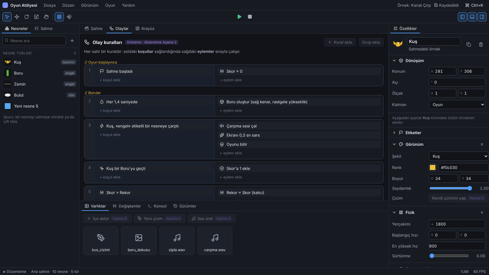
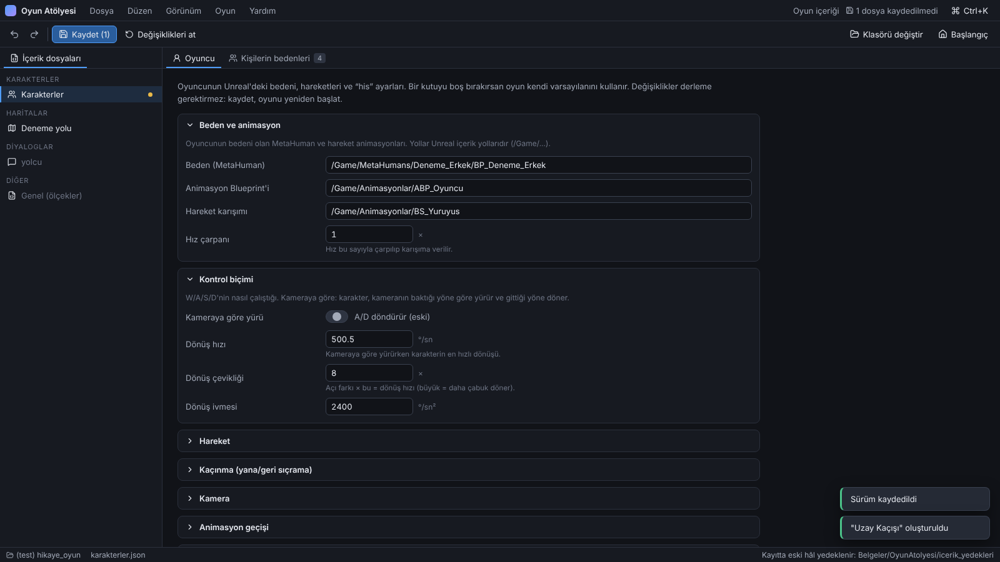
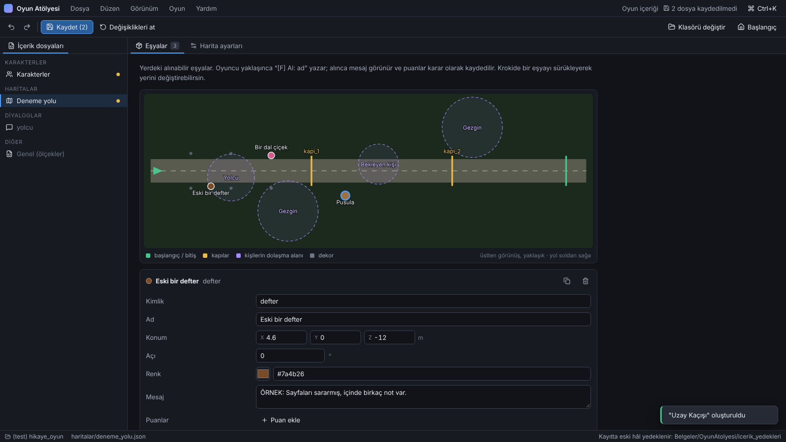

# Oyun Atölyesi — Kullanım Kılavuzu

Bu kılavuz, Oyun Atölyesi'ndeki **her ekranı, her düğmeyi ve her menüyü** ve aracın
**hangi adımlarla geliştirildiğini** anlatır. Claude her çalışmada kılavuzu günceller.
Yeni bir düğme eklenince, değişince ya da bir özellik "yakında" olmaktan çıkınca burası da değişir.

> Son güncelleme: 2026-11-16 (gece) · Araç sürümü: 0.4 (Oyun içeriği düzenleyicisi: karakterler, kişiler, harita, eşyalar)

**İçindekiler**
1. [Temel kavramlar](#1-temel-kavramlar)
2. [Başlangıç ekranı](#2-başlangıç-ekranı)
3. [Editör ekranının bölümleri](#3-editör-ekranının-bölümleri)
4. [Menü çubuğu](#4-menü-çubuğu)
5. [Araç çubuğu](#5-araç-çubuğu)
6. [Sol panel: Nesneler ve Sahne](#6-sol-panel-nesneler-ve-sahne)
7. [Orta alan: Sahne, Olaylar, Arayüz](#7-orta-alan-sahne-olaylar-arayüz)
8. [Sağ panel: Özellikler](#8-sağ-panel-özellikler)
9. [Hazır davranışlar](#9-hazır-davranışlar)
10. [Alt panel: Varlıklar, Değişkenler, Konsol, Sürümler](#10-alt-panel-varlıklar-değişkenler-konsol-sürümler)
11. [Durum çubuğu](#11-durum-çubuğu)
12. [Pencereler](#12-pencereler)
13. [Oyunu oynatmak](#13-oyunu-oynatmak)
14. [Klavye kısayolları](#14-klavye-kısayolları)
15. [Adım adım: ilk oyununu kur](#15-adım-adım-ilk-oyununu-kur)
16. [Oyun içeriği (3D hikâye oyunu)](#16-oyun-içeriği-3d-hikâye-oyunu)
17. [Geliştirme adımları (sürüm geçmişi)](#17-geliştirme-adımları-sürüm-geçmişi)

Rozetler: <kbd>Aşama N</kbd> yazan, soluk görünen bir düğme henüz çalışmaz; o aşamada gelecektir.

---

## 1. Temel kavramlar

| Kavram | Anlamı |
|---|---|
| **Proje** | Bir oyunun tamamı. Belgeler\OyunAtolyesi klasöründe saklanır, otomatik kaydedilir. |
| **Sahne** | Oyunun bir ekranı (ör. ana oyun, menü, bitiş). Bir projede birden fazla olabilir. |
| **Nesne türü** | Bir nesnenin tarifi: neye benzediği, nasıl hareket ettiği (ör. "Boru"). |
| **Örnek** | Sahneye yerleştirilmiş bir nesne türü. Aynı türden çok örnek olabilir; türü değiştirince hepsi değişir. |
| **Bileşen** | Nesne türüne eklenen yetenek: Görünüm, Fizik, Çarpışma alanı, Işık kaynağı, Davranışlar. |
| **Davranış** | Hazır hareket kalıbı: "Tuşla zıpla", "Sabit hızla kay" gibi. |
| **Katman** | Sahnedeki çizim sırası: Arka plan → Oyun → Arayüz (üstteki önde görünür). |
| **Etiket** | Nesneleri gruplamak için ad ("engel", "oyuncu"). Kurallarda kullanılacak (Aşama 2). |
| **Olay kuralı** | "Şu olunca → bunu yap" satırı (Aşama 2'de düzenlenebilir olacak). |
| **Değişken** | Skor, can gibi oyun sırasında değişen sayı/yazı. |
| **Sürüm** | Projenin notlu bir yedeği; istediğinde geri dönebilirsin. |

## 2. Başlangıç ekranı

Uygulama açılınca gelir.
- **Projelerin:** kayıtlı projelerin kartları. Bir karta tıkla → proje editörde açılır.
- **Yeni proje:** Yeni proje penceresini açar (ad yaz, boş ya da şablondan başla).
- **Oyun içeriğini aç:** 3D hikâye oyununun (hikaye_oyun) karakterlerini, haritalarını ve eşyalarını
  düzenleme ekranına geçer. İlk seferde oyun klasörünü seçmeni ister. Ayrıntı: [Bölüm 16](#16-oyun-içeriği-3d-hikâye-oyunu).
- **Proje klasörünü aç:** projelerin saklandığı klasörü Windows Gezgini'nde açar.
- İlk açılışta "Örnek: Kanat Çırp" projesi kendiliğinden oluşturulur.
- Eski (v0.1) projeler açılınca yeni biçime otomatik dönüştürülür; konsola bir not düşülür.

## 3. Editör ekranının bölümleri

| Yer | Ne var |
|---|---|
| En üst | **Menü çubuğu** (Dosya, Düzen, Görünüm, Oyun, Yardım), proje adı, kayıt durumu, Ctrl+K düğmesi |
| Üstün altı | **Araç çubuğu**: araçlar, ızgara, mıknatıs, oynat/duraklat/durdur, panel düğmeleri |
| Sol | **Nesneler** ve **Sahne** (ağaç) sekmeleri |
| Orta | **Sahne**, **Olaylar**, **Arayüz** sekmeleri |
| Sağ | **Özellikler**: seçili şeyin bütün ayarları |
| Alt | **Varlıklar**, **Değişkenler**, **Konsol**, **Sürümler** |
| En alt | **Durum çubuğu** |

Paneller arasındaki ince çizgileri sürükleyerek panelleri genişletip daraltabilirsin. Düzen hatırlanır.

## 4. Menü çubuğu

Menüdeki her komut **komut paletinde** (Ctrl+K) de aranabilir.

**Dosya**
| Komut | Kısayol | Ne yapar |
|---|---|---|
| Yeni proje… | Ctrl+N | Yeni proje penceresi |
| Proje aç… | Ctrl+O | Başlangıç ekranına döner, oradan proje seçilir |
| Kaydet | Ctrl+S | Hemen kaydeder (normalde zaten otomatik kaydedilir) |
| Sürüm kaydet… | Ctrl+Shift+S | Alt paneldeki Sürümler sekmesini açar, not kutusuna götürür |
| Proje ayarları… | — | Oyun adı, ekran boyutu, başlangıç sahnesi |
| Proje klasörünü aç | — | Projelerin klasörünü açar |
| Dışa aktar: HTML oyun | — | <kbd>Aşama 5</kbd> |
| Dışa aktar: Windows .exe | — | <kbd>Aşama 5</kbd> |

**Düzen**
| Komut | Kısayol | Ne yapar |
|---|---|---|
| Geri al | Ctrl+Z | Son değişikliği geri alır. Bir sürükleme, bir yazı kutusuna yazılan kelime ya da art arda ok tuşu basışları tek adım sayılır. En fazla 200 adım geriye gidilir. Proje kapanınca geçmiş sıfırlanır. |
| Yinele | Ctrl+Y (ya da Ctrl+Shift+Z) | Geri alınanı yeniden yapar. Geri aldıktan sonra yeni bir değişiklik yaparsan yinelenecek adımlar silinir. |
| Sahnedeki her şeyi seç | Ctrl+A | Açık sahnedeki bütün nesneleri seçer (gizli ya da kilitli katmandakiler hariç) |
| Seçimi kaldır | Esc | Seçili nesneleri bırakır |
| Çoğalt | Ctrl+D | Seçili örnekleri (birden fazlaysa hepsini) ya da nesne türünü kopyalar; kopyalar seçili olur |
| Sil | Delete | Seçili örnekleri siler; nesne türü seçiliyse türü ve bütün örneklerini siler |
| Yeni nesne türü | Ctrl+Shift+N | Listeye yeni bir mavi kare ekler |
| Ayarlar… | Ctrl+, | Ayarlar penceresi |

**Düzen → Hizala bölümü** (en az bir nesne seçiliyken; sağ paneldeki **Hizala** kartında düğme olarak da var)
| Komut | Kısayol | Ne yapar |
|---|---|---|
| Sola hizala / Yatay ortala / Sağa hizala | Alt+A / Alt+H / Alt+D | Birden fazla nesne seçiliyse sol kenarlarını, ortalarını ya da sağ kenarlarını aynı hizaya getirir. **Tek nesne** seçiliyse sahneye göre hizalar (ör. Yatay ortala → sahnenin tam ortasına). |
| Üste hizala / Dikey ortala / Alta hizala | Alt+W / Alt+V / Alt+S | Aynısı, yukarı-aşağı yönde |
| Yatay eşit dağıt / Dikey eşit dağıt | — | En az 3 nesne seçiliyken: en soldaki ve en sağdaki (ya da en üst/alttaki) yerinde kalır, aradaki boşluklar eşitlenir |

Hizalamada döndürülmüş nesnelerin kapladığı alan hesaba katılır.

**Görünüm**
| Komut | Kısayol | Ne yapar |
|---|---|---|
| Komut paleti | Ctrl+K | Bütün komutları arayıp çalıştırma kutusu |
| Sol / Sağ / Alt paneli göster-gizle | Ctrl+B / Ctrl+Alt+B / Ctrl+J | Panelleri açar-kapar |
| Izgarayı göster/gizle | Ctrl+' | Sahnedeki kareli çizgiler |
| Çarpışma alanlarını göster/gizle | Ctrl+Shift+C | Nesnelerin çarpışma sınırlarını çizer (kırmızı = içinden geçilmez, yeşil = geçilir) |
| Izgaraya yapış (mıknatıs) | Shift+M | Sürüklenen nesneler ızgaraya hizalanır |
| Yakınlaştır / Uzaklaştır | Ctrl++ / Ctrl+- | Sahne yakınlaştırma |
| Sahneyi ekrana sığdır | Ctrl+0 | Bütün sahneyi görünür yapar |
| Sahne / Olay kuralları / Arayüz düzenleyici | Ctrl+1 / 2 / 3 | Orta sekmeler arası geçiş |
| Araç: Seç / Taşı / Döndür / Ölçekle / Kaydır | V / W / E / R / H | Araç seçimi (oynarken çalışmaz, o tuşlar oyuna gider) |

**Oyun**
| Komut | Kısayol | Ne yapar |
|---|---|---|
| Oynat | F5 | Sahneyi oynatır |
| Duraklat / devam | F6 | Oyunu dondurur / sürdürür |
| Durdur | Shift+F5 | Oyunu bitirip düzenlemeye döner (oyun projeyi değiştirmez) |
| Ölümsüz test modu | — | <kbd>Aşama 2</kbd> |

**Oyun → Oyun içeriği bölümü** (3D hikâye oyunu; [Bölüm 16](#16-oyun-içeriği-3d-hikâye-oyunu))
| Komut | Kısayol | Ne yapar |
|---|---|---|
| Oyun içeriğini aç… | Ctrl+Shift+O | Oyun içeriği ekranına geçer (klasör daha önce seçildiyse doğrudan açar) |
| Oyun klasörünü değiştir… | — | Başka bir oyun klasörü seçtirir (kaydedilmemiş değişiklik varsa önce kaydetmeni ister) |
| Oyun içeriğini dosyalardan yeniden oku | — | Dosyaları diskten yeniden okur (ör. GitHub Desktop'ta Pull yaptıktan sonra) |

**Yardım:** Klavye kısayolları (F1), Oyun Atölyesi hakkında.

**Sağ üst köşe:** proje adı · kayıt durumu (Kaydediliyor… / Kaydedildi / Kaydedilemedi) · **Ctrl+K** düğmesi (komut paleti).

## 5. Araç çubuğu

Soldan sağa:
| Düğme | Ne yapar |
|---|---|
| ↶ Geri al (Ctrl+Z) | Son değişikliği geri alır; geri alınacak bir şey yoksa soluk görünür |
| ↷ Yinele (Ctrl+Y) | Geri alınanı yeniden yapar |
| 🖱 Seç (V) | Nesneye tıklayıp seçer, sürükleyerek taşır; boş alanda sürükleyince kutu seçimi yapar |
| ✥ Taşı (W) | Sürükleyerek taşır (Seç gibi kutu seçimi de yapar) |
| ↻ Döndür (E) | Nesneyi tutup çevirerek döndürür; Shift ile 15°'lik adımlar |
| ⤢ Ölçekle (R) | Nesneyi tutup merkezden uzaklaştırarak büyütür/küçültür |
| ✋ Kaydır (H) | Sahne görüntüsünü kaydırır (Boşluk basılı tutup sürüklemek ya da orta fare tuşu da aynı işi yapar) |
| ▦ Izgara | Izgarayı aç/kapa |
| 🧲 Mıknatıs | Izgaraya yapışmayı aç/kapa |
| ▶ Oynat (ortada) | Oyunu başlatır; duraklatılmışsa sürdürür |
| ⏸ Duraklat | Oynarken ▶ yerine görünür |
| ■ Durdur | Oyunu bitirir |
| Sağdaki üç panel simgesi | Sol, alt ve sağ paneli açar/kapar |

Aktif olan düğme mavi çerçeveli görünür. Üstüne gelince adı ve kısayolu yazar.

## 6. Sol panel: Nesneler ve Sahne

**Nesneler sekmesi**
- **Nesne ara** kutusu: ada ya da etikete göre süzer.
- **+** düğmesi: yeni nesne türü.
- Listedeki satır: küçük resim, ad ve ilk etiket. **Tıkla** → türün ayarları sağda açılır.
  **Sahneye sürükle** ya da **çift tıkla** → sahneye bir örnek eklenir.

**Sahne sekmesi (ağaç)**
- **Sahneler** listesi ve yanındaki **+** (yeni sahne). "başlangıç" rozeti oyunun açıldığı sahneyi gösterir.
- **Katmanlar ve nesneler:** her katmanın yanında 👁 (gizle/göster) ve 🔒 (kilitle: o katmandaki
  nesneler tıklanıp taşınamaz). Altında o katmandaki örnekler ve konumları; tıklayınca seçilir.
  **Shift ya da Ctrl ile tıklarsan** seçime eklenir/çıkarılır. Seçili satırlar mavi görünür.

## 7. Orta alan: Sahne, Olaylar, Arayüz

**Sahne sekmesi**
- Mavi kesik çizgili çerçeve oyun ekranının sınırıdır; oynarken yeşile döner.
- **Fare tekerleği:** imlecin olduğu yere yakınlaşır/uzaklaşır.
- **Sol üst:** sahne seçici (açılır liste). Oynarken yanında "Oynuyor · <tuşlar>" şeridi çıkar.
- **Sağ üst:** − / yüzde / + / ⛶ (sığdır).
- **Seçme:** nesneye tıkla. **Shift+tık** seçime ekler ya da seçimden çıkarır. **Boş bir yerden
  sürüklersen** mavi bir kutu çizilir; kutuya değen bütün nesneler seçilir (Shift basılıysa eskilerin
  üstüne eklenir). Gizli ya da kilitli katmandaki nesneler seçilmez.
  
- **Tek nesne seçiliyken** etrafında mavi kutu, köşelerde beyaz kareler ve üstte yuvarlak bir tutamaç görünür:
  - **Köşe karesini sürükle** → boyutlandırır; karşı köşe yerinde kalır. **Shift** basılıysa en-boy oranı korunur.
  - **Üstteki yuvarlağı sürükle** → döndürür (Döndür aracını seçmeye gerek yok). **Shift** ile 15°'lik adımlar.
  - Fare tutamaçların üstüne gelince imleç şekil değiştirir.
- **Birden fazla nesne seçiliyken** her birinin çerçevesi ve hepsini saran kesikli bir kutu görünür.
  Herhangi birini sürüklersen **hepsi birlikte taşınır**. Koyu mavi çerçeveli olan "asıl seçili" nesnedir;
  sağ panel onun ayarlarını gösterir.
- **Ok tuşları** seçili nesneleri 1 piksel, **Shift + ok** 10 piksel kaydırır (yazı kutusundayken değil).
- Sahnenin altında sahne adı ve boyutu yazar.

**Olaylar sekmesi** 
Her satır bir kural: solda **koşullar**, sağda **eylemler**. Şimdilik yalnızca gösteriliyor;
"Kural ekle", "Grup ekle", "+ koşul ekle", "+ eylem ekle" <kbd>Aşama 2</kbd>.

**Arayüz sekmesi:** skor yazısı, can çubuğu gibi ekran öğeleri — <kbd>Aşama 2 ve 4</kbd>.

## 8. Sağ panel: Özellikler

Ne seçiliyse onun ayarları görünür. Her kart başlığına tıklayınca katlanır/açılır; kartın sağındaki
🗑 o bileşeni kaldırır.

**Hiçbir şey seçili değilken — Sahne kartı:** Ad, Boyut (G genişlik, Y yükseklik), Arka plan rengi.

**Üst kısım:** nesnenin küçük resmi, adı (yazarak değiştirilebilir), "Sahnedeki örnek" ya da
"Nesne türü · sahnede N örnek", **Çoğalt** ve **Sil** düğmeleri.

**Hizala** (sahnedeki bir örnek seçiliyse): 8 düğme — sola, yatay ortaya, sağa, üste, dikey ortaya,
alta hizala, yatay ve dikey eşit dağıt. Başlıkta kaç nesne seçili olduğu yazar ("sahneye göre" yazıyorsa
tek nesne seçilidir ve sahnenin kenarlarına göre hizalanır). Ayrıntı: Düzen → Hizala.

**Dönüşüm** (yalnızca sahnedeki bir örnek seçiliyse): Konum X/Y, Açı, Ölçek X/Y, Katman.
Bunlar yalnızca o örneği etkiler. Altındaki kartlar türün bütün örneklerini etkiler.

**Etiketler:** virgülle ayrılmış adlar (ör. `engel, tehlike`).

**Görünüm:** Şekil (daire, kare, üçgen, elmas, yıldız, kuş, yarasa), Renk, Boyut G/Y, Saydamlık,
"Kendi çizimini yap" <kbd>Aşama 5</kbd>.

**Fizik:**
| Ayar | Anlamı |
|---|---|
| Yerçekimi | Aşağı doğru çekiş. 0 = havada asılı kalır. Kuş için ~1800 |
| Başlangıç hızı X/Y | Oyun başlarken sahip olduğu hız (sağa +X, aşağı +Y) |
| En yüksek hız | Nesnenin ulaşabileceği en yüksek hız. 0 = sınırsız |
| Sürtünme (0–1) | Her 0,1 saniyede yatay hızın bu oranı kaybolur (0,2 → yaklaşık 1 saniyede durur) |

**Çarpışma alanı:**
| Ayar | Anlamı |
|---|---|
| Biçim | Daire ya da Kutu |
| Ölçek | Alanı görünüme göre küçültür/büyütür (0,8 = biraz bağışlayıcı) |
| Katı — İçinden geçilemez | İşaretliyse fizikli nesneler içinden geçemez, üstünde durur |

İpucu: Görünüm menüsünden "Çarpışma alanlarını göster"i açarak alanları görebilirsin.

**Işık kaynağı:** Yarıçap, Güç, Renk (ayarlanabiliyor; karanlık efekti <kbd>Aşama 3</kbd>).

**Davranışlar:** eklenen her davranış bir kutu olarak görünür; ayarları altındadır, 🗑 kaldırır.
**+ Davranış ekle…** listesinden yenisi eklenir. Ayrıntı için bir sonraki bölüm.

**+ Bileşen ekle…:** türde olmayan bileşenleri ekler. Parçacık yayıcı <kbd>Aşama 3</kbd>,
Ses kaynağı <kbd>Aşama 4</kbd>, Animasyon <kbd>Aşama 5</kbd>.

## 9. Hazır davranışlar

| Davranış | Ayarlar | Ne yapar |
|---|---|---|
| **Tuşla zıpla / uç** | Tuş (Boşluk, Yukarı/Aşağı/Sol/Sağ ok, W, A, S, D, Enter, Fare tıklaması), Güç | Tuşa her basışta nesneyi yukarı fırlatır. Basılı tutmak tekrar zıplatmaz. Fizik bileşeniyle kullan. |
| **Sabit hızla kay** | Hız, Yön (sola/sağa/yukarı/aşağı) | Nesneyi saniyede "Hız" piksel kaydırır (borular, engeller). |
| **Ekrandan çıkınca yok ol** | Kenar payı | Nesne sahnenin tamamen dışına çıkınca silinir. Sahnenin dışında doğan nesne önce içeri girmelidir. |
| Rastgele üretici | — | <kbd>Aşama 2</kbd> |
| Aşağı yukarı süzül | — | <kbd>Aşama 3</kbd> |
| Platform karakteri, Yukarıdan bakış hareketi | — | <kbd>Aşama 5</kbd> |

## 10. Alt panel: Varlıklar, Değişkenler, Konsol, Sürümler

- **Varlıklar:** projedeki çizimler, resimler, sesler. "İçe aktar", "Yeni çizim" <kbd>Aşama 5</kbd>, "Ses üret" <kbd>Aşama 4</kbd>.
- **Değişkenler:** tablo (Ad, Tür: Sayı/Metin/Doğru-Yanlış, Başlangıç değeri, Kalıcı). Başlıktaki
  **+** yeni değişken ekler. "Kalıcı" işaretliyse oyun kapanınca da saklanır (rekor gibi; <kbd>Aşama 2</kbd>).
- **Konsol:** aracın mesajları (proje açıldı, oyun başladı, hatalar). Renkler: normal / uyarı / hata.
- **Sürümler:** not kutusu + **Sürüm kaydet**. Listede her sürümün tarihi ve notu, yanında
  **Geri yükle** düğmesi (yanlışlıkla basılmasın diye "Emin misin? Tekrar tıkla" der, ikinci tıklamada
  geri yükler). Geri yüklemeden önce mevcut hal otomatik olarak yedeklenir.

## 11. Durum çubuğu

Soldan: durum noktası ve yazısı (gri **Düzenleme**, yeşil **Oynuyor**, sarı **Duraklatıldı**),
sahne adı · nesne sayısı · tür sayısı. Sağda: imlecin sahnedeki konumu (x, y), yakınlaştırma yüzdesi, FPS (saniyedeki kare).

## 12. Pencereler

- **Yeni proje:** Proje adı, "Boş proje" ya da "Şablondan başla: Örnek: Kanat Çırp", Oluştur/Vazgeç.
  Ad boşsa ya da aynı adda proje varsa uyarır.
- **Proje ayarları:** proje adı, oyun ekranı boyutu, başlangıç sahnesi.
- **Ayarlar:** Izgara boyutu (8–64 piksel), Izgara göster, Çarpışma alanları göster, Mıknatıs,
  Otomatik kayıt, Arayüz ölçeği (%90–%125), Tema (koyu; açık tema yakında).
- **Komut paleti (Ctrl+K):**  Yaz → ok tuşlarıyla seç → Enter.
- **Klavye kısayolları (F1)** ve **Hakkında**.
- Pencereler Esc ile kapanır.

## 13. Oyunu oynatmak

1. ▶ düğmesine ya da **F5**'e bas. Üstte yeşil şerit ve "Oynuyor · Boşluk" gibi tuş ipucu çıkar.
2. Oyun, davranışlarda seçtiğin tuşlarla ya da fare tıklamasıyla oynanır.
3. **F6** duraklatır, **Shift+F5** durdurur. Oynarken olan hiçbir şey projeni değiştirmez;
   durdurunca her şey eski yerine döner.
4. Şimdilik çalışanlar: yerçekimi, hız, sürtünme, katı nesneler, üç hazır davranış.
   Skor, oyun bitti gibi kurallar <kbd>Aşama 2</kbd>.

## 14. Klavye kısayolları

| Kısayol | İş | Kısayol | İş |
|---|---|---|---|
| Ctrl+N | Yeni proje | F5 | Oynat |
| Ctrl+Shift+O | Oyun içeriğini aç | | |
| Ctrl+O | Proje aç | F6 | Duraklat / devam |
| Ctrl+S | Kaydet | Shift+F5 | Durdur |
| Ctrl+Shift+S | Sürüm kaydet | Ctrl+K | Komut paleti |
| Ctrl+Z | Geri al | Ctrl+Y / Ctrl+Shift+Z | Yinele |
| Ctrl+A | Sahnedeki her şeyi seç | Esc | Seçimi kaldır |
| Oklar / Shift+oklar | Seçileni 1 / 10 px kaydır | Shift+tık | Seçime ekle / çıkar |
| Alt+A / Alt+H / Alt+D | Sola / yatay orta / sağa hizala | Alt+W / Alt+V / Alt+S | Üste / dikey orta / alta hizala |
| Ctrl+D | Çoğalt | F1 | Kısayollar |
| Delete | Sil | Ctrl+, | Ayarlar |
| Ctrl+Shift+N | Yeni nesne türü | Ctrl+B / Ctrl+Alt+B / Ctrl+J | Sol / sağ / alt panel |
| V W E R H | Seç, Taşı, Döndür, Ölçekle, Kaydır | Ctrl+' | Izgara |
| Shift+M | Mıknatıs | Ctrl+Shift+C | Çarpışma alanları |
| Ctrl++ / Ctrl+- / Ctrl+0 | Yakınlaştır / uzaklaştır / sığdır | Ctrl+1/2/3 | Sahne / Olaylar / Arayüz |
| Boşluk + sürükle | Sahneyi kaydır | Fare tekerleği | Yakınlaştır |
| Boş alanda sürükle | Kutu ile seç | Shift (köşe / döndürme tutamacında) | Oranı koru / 15° adım |

## 15. Adım adım: ilk oyununu kur

Şu an yapılabilen en basit oyun: zıplayan bir top ve kayan engeller.
1. **Ctrl+N** → ad yaz ("Top") → Boş proje → Oluştur.
2. Soldaki **+** ile yeni nesne türü oluştur, sağda adını "Top" yap; Şekil: Daire.
3. **+ Bileşen ekle → Fizik** (Yerçekimi 1500). **+ Bileşen ekle → Çarpışma alanı** (Biçim: Daire).
4. **+ Bileşen ekle → Davranışlar**, sonra **+ Davranış ekle → Tuşla zıpla / uç** (Tuş: Boşluk, Güç: 500).
5. Yeni bir tür daha: "Zemin", Boyut G 960 / Y 60, Çarpışma alanı (Kutu, **Katı** işaretli).
6. Yeni bir tür daha: "Engel", Çarpışma alanı (Kutu, Katı), Davranışlar: **Sabit hızla kay** + **Ekrandan çıkınca yok ol**.
7. Nesneleri soldan sahneye sürükle: Top sola, Zemin alta, birkaç Engel sağa.
8. **F5** ile oyna, Boşluk ile zıpla. Beğendiğin hali **Ctrl+Shift+S** ile sürüm olarak kaydet.

## 16. Oyun içeriği (3D hikâye oyunu)

Oyun Atölyesi, 3D hikâye oyununun (`hikaye_oyun`) **içerik dosyalarını** kod yazmadan düzenler.
Oyun bu dosyaları her açılışta okur; yani burada değiştirip **kaydedince**, oyunu yeniden başlatman yeter
(Unreal'de derleme gerekmez).

**Nasıl açılır:** Başlangıç ekranında **Oyun içeriğini aç** (ya da Oyun menüsü → Oyun içeriğini aç…, **Ctrl+Shift+O**).
İlk seferde bir klasör seçme penceresi açılır: oyunun ana klasörünü seç (GitHub Desktop'un indirdiği
`hikaye_oyun` klasörü; içinde `icerik` klasörü olan). Seçim hatırlanır.

**Ekranın bölümleri**
| Yer | Ne var |
|---|---|
| Üst çubuk | Geri al / Yinele, **Kaydet (n)** (n = kaydedilmemiş dosya sayısı), **Değişiklikleri at**, **Klasörü değiştir**, **Başlangıç** |
| Sol | **İçerik dosyaları**: Karakterler, Haritalar, Diyaloglar, Diğer. Sarı nokta = kaydedilmemiş değişiklik var |
| Orta | Seçili dosyanın düzenleyicisi |
| Alt | Oyun klasörü ve açık dosya |

**Karakterler → Oyuncu sekmesi.** Kartlar halinde bütün oyuncu ayarları (başlığa tıklayınca açılır/kapanır):
- **Beden ve animasyon:** MetaHuman bedeninin, Animation Blueprint'in ve hareket karışımının Unreal yolları (`/Game/...`), hız çarpanı.
- **Kontrol biçimi:** *Kameraya göre yürü* anahtarı (açık = W/A/S/D kameranın baktığı yöne göre yürütür, karakter gittiği yöne döner;
  kapalı = eski biçim, A/D karakteri döndürür) ve serbest dönüş hızı / çevikliği / ivmesi.
- **Hareket**, **Kaçınma**, **Kamera**, **Animasyon geçişi**, **Dövüş**, **Doğallık**, **Etkileşim anları** (0–1 arası; kaydırıcı da var),
  **Çanta** (göster, konum, boyut, renk), **Animasyonlar** (her hareketin Unreal yolu), **Animasyon yuvaları**.
- Her sayının yanında birimi yazar (cm/sn, °, sn…). Kutuyu **boş bırakırsan** oyun kendi varsayılanını kullanır.
  Virgül de nokta da olur. Kutudayken **↑/↓** tuşları değeri bir adım artırıp azaltır (Shift ile 10 adım).
- Oyuna sonradan eklenen ve henüz açıklaması yazılmamış bir ayar da ilgili kartta **yeni** rozetiyle görünür ve düzenlenebilir.
- Yanlış yazılmış bir Unreal yolu (ör. `/Game/` ile başlamıyor) kutunun altında sarı uyarıyla gösterilir.

**Karakterler → Kişilerin bedenleri sekmesi.** Haritalardaki her kişinin (npc) MetaHuman bedeni:
kimlik, beden yolu, isteğe bağlı Animation Blueprint. Kartın sağ üstündeki çöp kutusu kişiyi siler.
Altta, haritada olup bedeni seçilmemiş kişiler için hazır **+ ekle** düğmeleri çıkar. Kimlik yalnız küçük harf, rakam ve `_` olabilir;
haritada olmayan bir kimlik yazarsan üstteki **Dikkat** kutusu uyarır.

**Harita → Eşyalar sekmesi.** Yerdeki alınabilir eşyalar (oyunda yaklaşınca “[F] Al”).

- Üstte haritanın **krokisi** (üstten görünüş, yol soldan sağa ilerler): yeşil üçgen başlangıç, yeşil çizgi bitiş,
  sarı çizgiler kapılar, mor kesikli daireler kişilerin dolaşma alanı, gri noktalar dekor, renkli daireler eşyalar.
  **Bir eşyayı sürükleyerek yerini değiştirebilirsin**; tıklayınca kartı seçilir.
- Her eşyanın kartı: kimlik, ad, konum (metre), açı, renk, mesaj (alınca ekranda yazan), **puanlar** (ölçek seç + sayı; **+ Puan ekle**),
  **Elde duruşu** (isteğe bağlı: eşyanın sağ eldeki konumu/açısı; **Varsayılana dön** ile kaldırılır).
- Kartın sağ üstünde **Çoğalt** ve **Sil**; en altta **+ Eşya ekle** (yolun kenarına yeni bir eşya koyar).

**Harita → Harita ayarları sekmesi.** Genel (ad, tema, not), **Unreal: dekor, zemin ve yol yüzeyi** (model açı düzeltmesi,
zemin/yol malzeme klasörleri ve karo boyları), Yol (uzunluk, genişlik, renkler, orta şerit), Işık ve gökyüzü, Başlangıç ve bitiş.

**Diyaloglar ve diğer dosyalar** şimdilik yalnızca okunur gösterilir <kbd>Aşama 4</kbd>.

**Kaydetme ve güvenlik**
- Hiçbir şey kendiliğinden kaydedilmez: **Kaydet** (Ctrl+S) değişen bütün dosyaları birden yazar.
- Her kayıttan önce dosyanın eski hâli `Belgeler\OyunAtolyesi\icerik_yedekleri\<tarih>\` altına kopyalanır.
- Dosyadaki düzenleyicide görünmeyen alanlara (ör. dekor listesi) dokunulmaz; girinti ve sıra korunur.
- **Ctrl+Z / Ctrl+Y** bu ekranda da çalışır (krokide bir sürükleme tek adım). **Değişiklikleri at** son kayda döner.
- Kaydetmeden **Başlangıç**'a basarsan düğme "Kaydetmeden çık?" olur; ikinci basışta çıkar.
- Kaydettikten sonra değişiklikler oyun klasöründedir; GitHub Desktop'ta görünür, oradan commit edebilirsin.

## 17. Geliştirme adımları (sürüm geçmişi)

Her satır bir çalışma oturumudur; ayrıntılar GUNLUK.md'de.

| Tarih | Adım | Neler geldi |
|---|---|---|
| 2026-11-14 | **v0.1** — ilk deneme | Yarasa oyununa özel ayar paneli, canlı önizleme, 7 dokunma etkisi, sürümler, HTML dışa aktarma. (Şimdi `eski_v01/` altında.) |
| 2026-11-14 akşam | **v0.2** — yeni arayüz | Genel amaçlı oyun aracına geçiş: menüler, araç çubuğu, paneller, sahne düzenleyici, nesne türleri ve bileşenler, olaylar önizlemesi, değişkenler, sürümler, komut paleti, ayarlar, eski projeleri dönüştürme. |
| 2026-11-14 gece | **Oyun motoru** | Gerçek fizik (yerçekimi, hız sınırı, sürtünme), daire/kutu çarpışma, içinden geçilemeyen nesneler; tuşu seçilebilen "Tuşla zıpla", yönlü "Sabit hızla kay", "Ekrandan çıkınca yok ol"; çarpışma alanlarını gösterme. |
| 2026-11-15 | Kılavuz | Bu kullanım kılavuzu başlatıldı. |
| 2026-11-15 gece | **v0.3** — Aşama 1 tamam | Köşe tutamaçlarıyla boyutlandırma, üst tutamaçla döndürme, çoklu seçim (Shift+tık, kutu seçimi, Ctrl+A), toplu taşıma/silme/çoğaltma, ok tuşlarıyla kaydırma, Düzen → Hizala (6 hizalama + 2 eşit dağıtma), geri al / yinele (araç çubuğunda da). |

| 2026-11-16 gece | **v0.4** — Oyun içeriği | Oyunun klasörünü açma (atolye.py, yol güvenliği, kayıttan önce yedek), **Oyun içeriği** ekranı: karakterler.json (oyuncunun bütün ayarları, kameraya göre kontrol, kişilerin MetaHuman bedenleri), harita (Unreal zemin/yol ve model açısı, yol, ışık, başlangıç/bitiş), **eşyalar** (kart + sürüklenebilir kroki, puanlar), uyarılar, ayrı geri al/yinele. |

**Sıradaki adımlar:** Aşama 2 — 3D görünüm (3D Harita sekmesi, yörünge kamerası, glTF modeller,
taşı/döndür/ölçekle tutamaçları, ışık ve gökyüzü önizlemesi).
