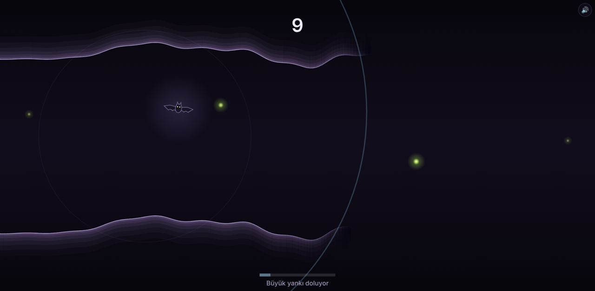
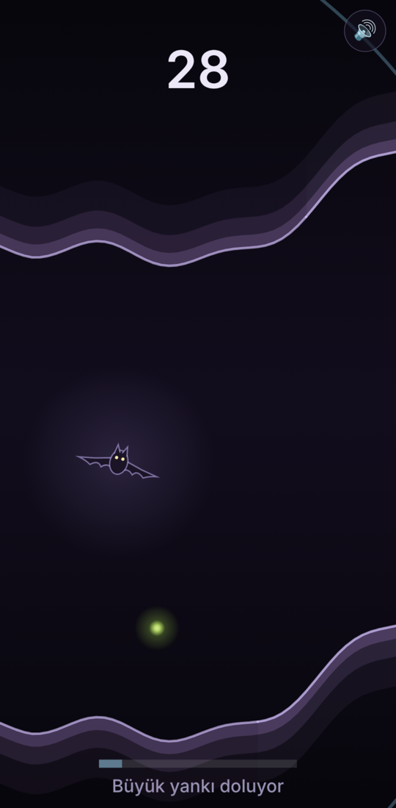

# Yankı — Çalışma Günlüğü

En yeni girdi en üsttedir.

## 2026-11-21 (gece) — Geniş ekrana tam sığıyor, mağara akarak beliriyor
**Bu gece yapılanlar** (senin ekran görüntülü geri bildirimin)
- **Ekrana sığma:** Geniş bilgisayar ekranında oyun artık pencerenin tamamını dolduruyor. Önceden oyun alanı belli bir genişlikte
  duruyordu ve sağda kalan şerit hiç temizlenmediği için orada eski karelerin izleri (yeşil lekeler) birikiyordu. Artık her
  karede bütün ekran baştan çiziliyor; çok dar ya da çok geniş ekranlarda oyun ortalanıyor, kenarlar koyu kalıyor.
- **Akıcı belirme:** Duvarlar artık "pencere pencere" değil, yankı dalgası ilerledikçe duvar boyunca **akarak** beliriyor ve yavaşça
  sönüyor. Yankı değdiği anda duvar birden parlamıyor, saniyenin onda biri içinde yumuşakça aydınlanıyor; yan yana parçalar
  arasındaki keskin sınırlar ve basamaklar kalktı. Kayanın içe doğru kararması da daha yumuşak.
- Bilgisayarda çift tıklanan **Yanki.html** de güncellendi.
- Testler: 11 birim testi (yan yana duvar parçaları arasında ani parlaklık sıçraması olmadığını ölçen yeni test dahil) +
  44 otomatik oynanış kontrolü: telefonlar ve 4 farklı bilgisayar ekranı (senin 1916×939 ekranın dahil); her birinde ekranın
  tamamının her karede yeniden çizildiği denetleniyor. Hepsi geçiyor.

**Nasıl denenir**
- **Bilgisayarda:** GitHub Desktop'ta **Fetch origin → Pull origin**, sonra `oyun_atolyesi\yanki\Yanki.html`'e çift tıkla. Tarayıcıyı tam
  ekran yap (F11) ve oyna: sağda şerit ya da leke kalmamalı; duvarlar yankıyla akarak görünmeli.
- **Telefonda:** GitHub Pages açıksa aynı bağlantı (https://harunyetkin.github.io/oyun_atolyesi/yanki/oyun/); oyunu bir kez kapatıp aç.

**Ekran görüntüleri**

**Küçük kararlar**
- Geniş ekranda ileriyi daha çok görüyorsun (ekran ne kadar genişse o kadar). Bu bilgisayarda oyunu biraz kolaylaştırıyor;
  istersen geniş ekranda görüşü sınırlayıp yanları koyu bırakabilirim.

**Senin kararın gereken konular**
- Önceki sorular hâlâ açık: yarasa (A) soldan sağa mı, (B) aşağıdan yukarı mı uçsun; Mor/Buz/Lav bölümleri ve yol ayrımları uygun mu?
  Cevabını gece çalışmasının sohbetine yazabilirsin.

**Sıradaki adım**
- Duraklat düğmesi, ardından sarkıt ve dikitler.

## 2026-11-19 (gece) — Yankı doğdu: telefonda oynanabilen ilk sürüm
**Bu gece yapılanlar**
- Yarasa oyunu **Yankı**'yı sıfırdan, telefonda oynanacak şekilde kurdum. Oyun Atölyesi deposunun içinde ama araçtan
  ayrı, kendi `yanki` klasöründe; kendi planı, yapılacaklar listesi ve günlüğü var.
- **Nasıl oynanıyor:** Mağara zifiri karanlık. Ekrana **dokununca** yarasa kanat çırpıp yükselir ve küçük bir **yankı** gönderir;
  yankı dalgası duvarlara değince duvarlar mor renkte bir an parlar, sonra yavaşça söner. **Basılı tutarsan** çok daha uzağa
  giden **büyük yankı** çıkar (alttaki mavi çubuk dolunca, ~5 saniyede bir). Yeşil **ateş böcekleri** +5 puan.
  Tavana ya da yere çarpınca oyun biter; skor ve **rekor** görünür, dokununca yeni (her seferinde farklı) bir mağara başlar.
- Mağara başta düz ve geniştir, ilerledikçe **kıvrılır, daralır** ve yarasa hızlanır.
- Sesler kodla üretildi (yankı "tık"ı, büyük yankı, böcek, çarpma); sağ üstte **ses düğmesi**. Çarpınca telefon kısa titrer (Android).
- **Uygulama gibi:** Telefonda ana ekrana eklenince kendi simgesiyle, tam ekran açılır; bir kez açtıktan sonra **internetsiz de** çalışır.
- Testler: 10 birim testi (mağara hiç kapanmıyor, otomatik pilot 40 saniye uçabiliyor vb.) + Pixel 7 ve iPhone 14 öykünmesiyle
  31 otomatik oynanış kontrolü (dokunma, büyük yankı, çarpma, yeniden başlama, ses düğmesi, internetsiz açılış); hepsi geçiyor.

**Bilgisayarda nasıl oynanır** (eklendi, 19.11): GitHub Desktop'ta **Fetch origin → Pull origin**, sonra `oyun_atolyesi\yanki`
klasöründeki **Yanki.html** dosyasına çift tıkla. Tarayıcıda açılır; **Boşluk** (ya da fare tıkı) = kanat çırp, basılı tut = büyük yankı.

**Telefonda nasıl denenir** (bir kerelik kurulum, 1 dakika)
1. Bilgisayardan GitHub'da `oyun_atolyesi` deposunu aç → üstte **Settings** → soldan **Pages**.
2. "Build and deployment" altında **Source: Deploy from a branch**, **Branch: main**, klasör **/ (root)** seç → **Save**.
3. 1–2 dakika sonra oyun şu adreste açılır: **https://harunyetkin.github.io/oyun_atolyesi/yanki/oyun/**
   Bu bağlantıyı telefonuna gönder (kendine e-posta/WhatsApp) ve aç.
4. Ana ekrana ekle: **Android (Chrome):** sağ üstteki ⋮ → "Ana ekrana ekle". **iPhone (Safari):** alttaki paylaş düğmesi → "Ana Ekrana Ekle".
5. Oyna: dokun, basılı tut, ateş böceklerini topla. Rekorunu kır.
Sonraki gecelerde yaptığım değişiklikler aynı bağlantıya kendiliğinden gelir (telefonda oyunu bir kez kapatıp açman yeter).

**Ekran görüntüleri**

**Küçük kararlar (ben seçtim, istersen değiştiririz)**
- Yarasa soldan sağa uçuyor (eski Yankı gibi), telefon dik tutuluyor. Dik ekranda ileriyi daha az görürsün; bu yüzden
  hız biraz düşük ve büyük yankı uzağı gösteriyor.
- Kanat çırpmak her seferinde küçük bir yankı da gönderiyor (ayrı bir düğme yok): tek parmakla oynansın diye.
- Duvarlar hem tavanda hem tabanda öldürücü; sarkıt, örümcek ağı gibi şeyler henüz yok (sırada).

**Senin kararın gereken konular**
- **Yön:** Yarasa (A) soldan sağa mı uçsun (şimdiki), yoksa (B) telefonun dikliğine uygun olarak **aşağıdan yukarı**, bacadan
  çıkar gibi mi? (B) dik ekranda ileriyi daha çok gösterir ama eski Yankı'dan farklı olur.
- **Bölümler:** PLAN'daki Mor → Buz → Lav bölümleri ve yol ayrımları önerimi uygun buluyor musun? Onaylarsan sıraya alırım.
- Cevabını gece çalışmasının sohbetine ya da `yanki/GERI_BILDIRIM.md`'ye yazabilirsin.

**Sıradaki adım**
- Telefonda deneyince söylediklerine göre his ayarı; sonra duraklat düğmesi ve sarkıt/dikitler.
