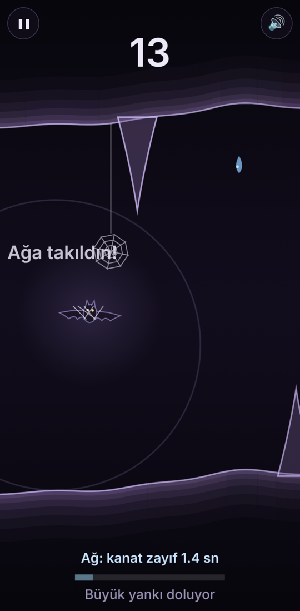
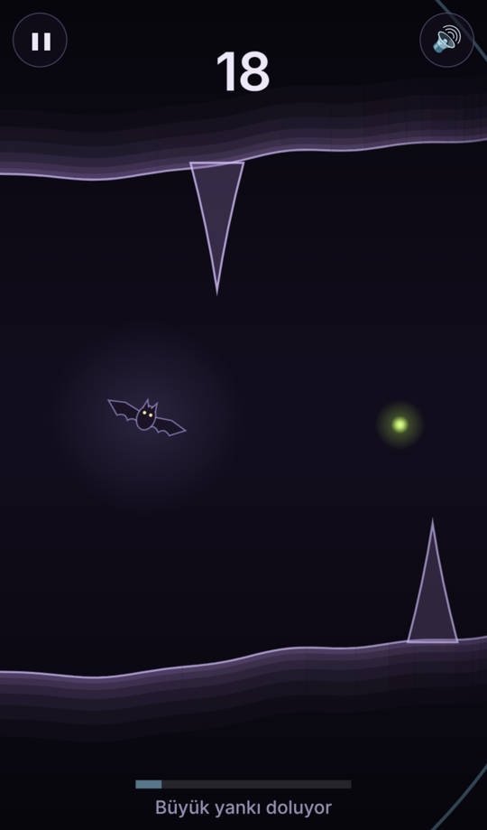
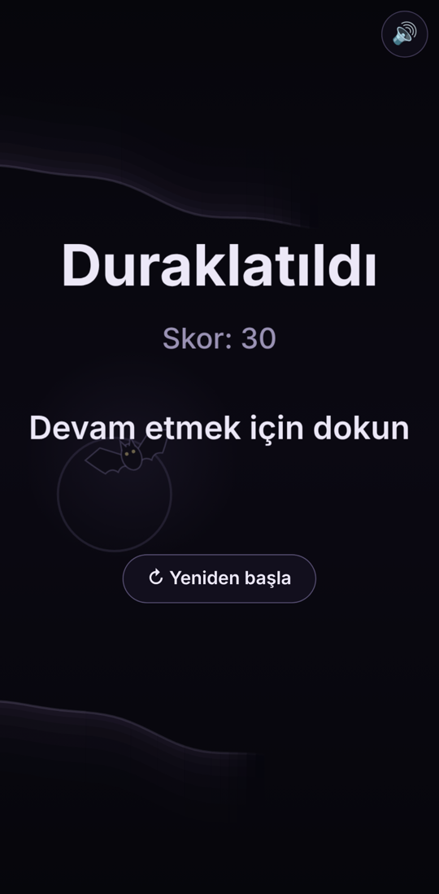
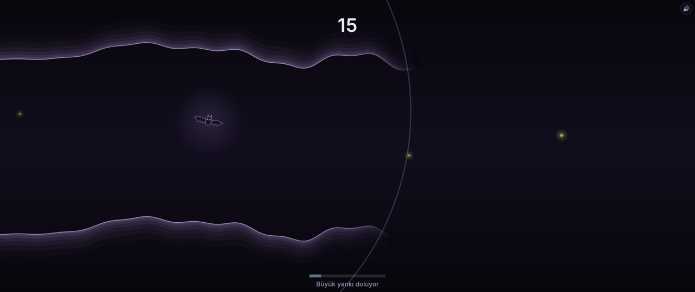
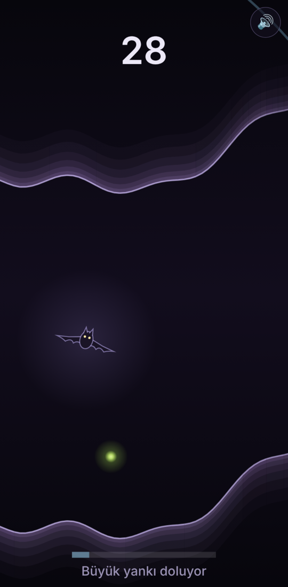

# Yankı — Çalışma Günlüğü

En yeni girdi en üsttedir.

## 2026-11-25 (gündüz) — Önü tamamen kör (senin isteğin)
- Yarasanın kendi ışığını kaldırdım: artık yakınındaki duvarlar, sarkıtlar, ağlar ve damlalar kendiliğinden görünmüyor.
- **Ateş böcekleri de artık parlamıyor**: onları da yalnız yankı değdiğinde, kısa bir süre görüyorsun; sonra sönüyorlar.
- Ekranda yarasanın kendisi ve yankı halkaları dışında hiçbir şey yok; her şeyi yankıyla bulman gerekiyor.
- Testlere bir piksel denetimi ekledim: yankı yokken ekranın ön tarafında parlayan hiçbir nokta olmamalı (geçiyor). 19 birim + 58 oynanış kontrolü.
- **Denemek için:** GitHub Desktop'ta Fetch/Pull, sonra `Yanki.html`'e çift tıkla (ya da sohbetteki dosyayı indir).

## 2026-11-25 (gece) — Örümcek ağları ve su damlaları
**Bu gece yapılanlar**
- Mağarada artık **öldürmeyen** iki tehlike var (ilk ~15 saniyeden sonra):
  - **Örümcek ağı:** geçidin ortasında asılı duruyor. Takılırsan **"Ağa takıldın!"** yazıyor, kanatlarına ağ telleri yapışıyor ve
    2 saniye kadar **kanat çırpışın zayıflıyor**, biraz da yavaşlıyorsun. Dikkatli olmazsan sonra bir sarkıta ya da yere çarpabilirsin.
  - **Su damlası:** tavanda asılı; yanına yaklaşınca **kopup düşüyor**. Üstüne düşerse **"Islandın!"** yazıyor, kanatlarından su
    damlıyor ve 4 saniye boyunca **ağırlaşıyorsun** (daha hızlı düşüyorsun, daha sık kanat çırpman gerekiyor).
- İkisi de duvarlar gibi yalnız **yankı değince** ya da yarasanın yakınına gelince görünüyor. Ekranın altında kalan süre yazıyor
  ("Ağ: kanat zayıf 1.4 sn"). Her birinin kendi sesi var; telefonda kısa titreşim.
- Sivrilerin dibine konmuyorlar (aynı yerde hem sarkıt hem ağ olmasın).
- Bilgisayarda çift tıklanan **Yanki.html** güncellendi.
- Testler: 18 birim testi (ağ ve damlanın etkisi, damlanın yaklaşınca kopması, etkinin süre sonunda geçmesi, yankıyla görünme) +
  56 otomatik oynanış kontrolü; hepsi geçiyor.

**Nasıl denenir**
- **Bilgisayarda:** GitHub Desktop'ta **Fetch origin → Pull origin**, `oyun_atolyesi\yanki\Yanki.html`'e çift tıkla. 15–20 saniye uç;
  yankı attıkça önünde beyaz bir ağ ya da mavi bir damla görebilirsin. Ağa gir: kanat çırpışın zayıflamalı.
- **Telefonda** (GitHub Pages açıksa): https://harunyetkin.github.io/oyun_atolyesi/yanki/oyun/

**Ekran görüntüleri**

**Küçük kararlar (ben seçtim)**
- Değerler ÖRNEK: ağ kanat gücünü %28 azaltıyor (2,2 sn), damla yerçekimini %30 artırıyor (4 sn). Oynayınca fazla/az gelirse söyle.

**Senin kararın gereken konular**
- Önceki sorular hâlâ açık: yarasa soldan sağa mı, aşağıdan yukarı mı uçsun; Mor/Buz/Lav bölümleri ve yol ayrımları uygun mu?
  Cevabını gece çalışmasının sohbetine yazabilirsin.

**Sıradaki adım**
- Yankıyı yutan yosun bölgeleri (o bölgede duvarlar görünmez); ardından bölüm sistemi (senin onayınla).

## 2026-11-23 (gece) — Sarkıtlar, dikitler, duraklat ve yumuşak başlangıç
**Bu gece yapılanlar**
- **Sarkıt ve dikitler:** Mağaranın tavanından sarkan ve yerden yükselen sivri kayalar geldi. Duvarlar gibi onlar da **yalnız yankı
  değince** (ya da yarasanın kendi soluk ışığına girince) görünüyor; çarparsan oyun biter ("Sarkıta çarptın"). Her birinin yanında
  her zaman geçilecek kadar yer bırakıyorum; oyunun başında (ilk ~10 saniye) hiç yok, ilerledikçe biraz sıklaşıyorlar.
  Ateş böcekleri artık sivrilerin içine düşmüyor.
- **Duraklat:** Oyun sırasında sol üstte **❚❚** düğmesi. Basınca oyun durur, "Duraklatıldı — Devam etmek için dokun" yazar ve altında
  **Yeniden başla** düğmesi çıkar. Telefonda başka uygulamaya geçip dönersen oyun kendiliğinden bu ekranda bekler. Bilgisayarda **Esc** ya da **P**.
- **Yumuşak başlangıç:** Telefonda denemenden haber gelmediği için zorluğu kendim yumuşattım: hızlanma ve mağaranın daralması ilk
  ~25 saniyede çok yavaş başlıyor, kıvrımlar da daha yavaş geliyor. Sonrası eskisi gibi zorlaşıyor.
- Bilgisayarda çift tıklanan **Yanki.html** güncellendi.
- Testler: 15 birim testi (otomatik pilot 4 farklı mağarada 50 saniye sarkıtlara çarpmadan uçabiliyor; sarkıta çarpınca biter;
  duraklatınca zaman durur) + 54 otomatik oynanış kontrolü; hepsi geçiyor.

**Nasıl denenir**
- **Bilgisayarda:** GitHub Desktop'ta **Fetch origin → Pull origin**, `oyun_atolyesi\yanki\Yanki.html`'e çift tıkla. ~10 saniye uç:
  yankı attıkça tavandan sarkan ve yerden çıkan sivriler görünmeli. **P**'ye bas: oyun durmalı; tekrar Boşluk: devam.
- **Telefonda** (GitHub Pages açıksa): https://harunyetkin.github.io/oyun_atolyesi/yanki/oyun/ — sol üstteki ❚❚ ile duraklat,
  başka uygulamaya geçip geri dön: "Devam etmek için dokun" görünmeli.

**Ekran görüntüleri**

**Senin kararın gereken konular**
- **Zorluk:** Oyunu oynadıysan: başı kolay mı, sarkıtlar çok mu sık? Kısaca yazman yeterli, ayarları ona göre değiştiririm.
- Önceki sorular hâlâ açık: yarasa (A) soldan sağa mı, (B) aşağıdan yukarı mı uçsun; Mor/Buz/Lav bölümleri ve yol ayrımları uygun mu?
  Cevabını gece çalışmasının sohbetine yazabilirsin.

**Sıradaki adım**
- Ölümcül olmayan tehlikeler: örümcek ağı (yavaşlatır) ve su damlası (ağırlaştırır).

## 2026-11-21 (gece) — Geniş ekrana tam sığıyor, mağara akarak beliriyor
**Bu gece yapılanlar** (senin ekran görüntülü geri bildirimin)
- **Ekrana sığma:** Geniş bilgisayar ekranında oyun artık pencerenin tamamını dolduruyor. Önceden oyun alanı belli bir genişlikte
  duruyordu ve sağda kalan şerit hiç temizlenmediği için orada eski karelerin izleri (yeşil lekeler) birikiyordu. Artık her
  karede bütün ekran baştan çiziliyor; çok dar ya da çok geniş ekranlarda oyun ortalanıyor, kenarlar koyu kalıyor.
- **Akıcı belirme:** Duvarlar artık "pencere pencere" değil, yankı dalgası ilerledikçe duvar boyunca **akarak** beliriyor ve yavaşça
  sönüyor. Yankı değdiği anda duvar birden parlamıyor, saniyenin onda biri içinde yumuşakça aydınlanıyor; yan yana parçalar
  arasındaki keskin sınırlar ve basamaklar kalktı. Kayanın içe doğru kararması da daha yumuşak.
- Bilgisayarda çift tıklanan **Yanki.html** de güncellendi.
- Testler: 11 birim testi (yan yana duvar parçaları arasında ani parlaklık sıçraması olmadığını ölçen yeni test dahil) +
  44 otomatik oynanış kontrolü: telefonlar ve 4 farklı bilgisayar ekranı (senin 1916×939 ekranın dahil); her birinde ekranın
  tamamının her karede yeniden çizildiği denetleniyor. Hepsi geçiyor.

**Nasıl denenir**
- **Bilgisayarda:** GitHub Desktop'ta **Fetch origin → Pull origin**, sonra `oyun_atolyesi\yanki\Yanki.html`'e çift tıkla. Tarayıcıyı tam
  ekran yap (F11) ve oyna: sağda şerit ya da leke kalmamalı; duvarlar yankıyla akarak görünmeli.
- **Telefonda:** GitHub Pages açıksa aynı bağlantı (https://harunyetkin.github.io/oyun_atolyesi/yanki/oyun/); oyunu bir kez kapatıp aç.

**Ekran görüntüleri**

**Küçük kararlar**
- Geniş ekranda ileriyi daha çok görüyorsun (ekran ne kadar genişse o kadar). Bu bilgisayarda oyunu biraz kolaylaştırıyor;
  istersen geniş ekranda görüşü sınırlayıp yanları koyu bırakabilirim.

**Senin kararın gereken konular**
- Önceki sorular hâlâ açık: yarasa (A) soldan sağa mı, (B) aşağıdan yukarı mı uçsun; Mor/Buz/Lav bölümleri ve yol ayrımları uygun mu?
  Cevabını gece çalışmasının sohbetine yazabilirsin.

**Sıradaki adım**
- Duraklat düğmesi, ardından sarkıt ve dikitler.

## 2026-11-19 (gece) — Yankı doğdu: telefonda oynanabilen ilk sürüm
**Bu gece yapılanlar**
- Yarasa oyunu **Yankı**'yı sıfırdan, telefonda oynanacak şekilde kurdum. Oyun Atölyesi deposunun içinde ama araçtan
  ayrı, kendi `yanki` klasöründe; kendi planı, yapılacaklar listesi ve günlüğü var.
- **Nasıl oynanıyor:** Mağara zifiri karanlık. Ekrana **dokununca** yarasa kanat çırpıp yükselir ve küçük bir **yankı** gönderir;
  yankı dalgası duvarlara değince duvarlar mor renkte bir an parlar, sonra yavaşça söner. **Basılı tutarsan** çok daha uzağa
  giden **büyük yankı** çıkar (alttaki mavi çubuk dolunca, ~5 saniyede bir). Yeşil **ateş böcekleri** +5 puan.
  Tavana ya da yere çarpınca oyun biter; skor ve **rekor** görünür, dokununca yeni (her seferinde farklı) bir mağara başlar.
- Mağara başta düz ve geniştir, ilerledikçe **kıvrılır, daralır** ve yarasa hızlanır.
- Sesler kodla üretildi (yankı "tık"ı, büyük yankı, böcek, çarpma); sağ üstte **ses düğmesi**. Çarpınca telefon kısa titrer (Android).
- **Uygulama gibi:** Telefonda ana ekrana eklenince kendi simgesiyle, tam ekran açılır; bir kez açtıktan sonra **internetsiz de** çalışır.
- Testler: 10 birim testi (mağara hiç kapanmıyor, otomatik pilot 40 saniye uçabiliyor vb.) + Pixel 7 ve iPhone 14 öykünmesiyle
  31 otomatik oynanış kontrolü (dokunma, büyük yankı, çarpma, yeniden başlama, ses düğmesi, internetsiz açılış); hepsi geçiyor.

**Bilgisayarda nasıl oynanır** (eklendi, 19.11): GitHub Desktop'ta **Fetch origin → Pull origin**, sonra `oyun_atolyesi\yanki`
klasöründeki **Yanki.html** dosyasına çift tıkla. Tarayıcıda açılır; **Boşluk** (ya da fare tıkı) = kanat çırp, basılı tut = büyük yankı.

**Telefonda nasıl denenir** (bir kerelik kurulum, 1 dakika)
1. Bilgisayardan GitHub'da `oyun_atolyesi` deposunu aç → üstte **Settings** → soldan **Pages**.
2. "Build and deployment" altında **Source: Deploy from a branch**, **Branch: main**, klasör **/ (root)** seç → **Save**.
3. 1–2 dakika sonra oyun şu adreste açılır: **https://harunyetkin.github.io/oyun_atolyesi/yanki/oyun/**
   Bu bağlantıyı telefonuna gönder (kendine e-posta/WhatsApp) ve aç.
4. Ana ekrana ekle: **Android (Chrome):** sağ üstteki ⋮ → "Ana ekrana ekle". **iPhone (Safari):** alttaki paylaş düğmesi → "Ana Ekrana Ekle".
5. Oyna: dokun, basılı tut, ateş böceklerini topla. Rekorunu kır.
Sonraki gecelerde yaptığım değişiklikler aynı bağlantıya kendiliğinden gelir (telefonda oyunu bir kez kapatıp açman yeter).

**Ekran görüntüleri**

**Küçük kararlar (ben seçtim, istersen değiştiririz)**
- Yarasa soldan sağa uçuyor (eski Yankı gibi), telefon dik tutuluyor. Dik ekranda ileriyi daha az görürsün; bu yüzden
  hız biraz düşük ve büyük yankı uzağı gösteriyor.
- Kanat çırpmak her seferinde küçük bir yankı da gönderiyor (ayrı bir düğme yok): tek parmakla oynansın diye.
- Duvarlar hem tavanda hem tabanda öldürücü; sarkıt, örümcek ağı gibi şeyler henüz yok (sırada).

**Senin kararın gereken konular**
- **Yön:** Yarasa (A) soldan sağa mı uçsun (şimdiki), yoksa (B) telefonun dikliğine uygun olarak **aşağıdan yukarı**, bacadan
  çıkar gibi mi? (B) dik ekranda ileriyi daha çok gösterir ama eski Yankı'dan farklı olur.
- **Bölümler:** PLAN'daki Mor → Buz → Lav bölümleri ve yol ayrımları önerimi uygun buluyor musun? Onaylarsan sıraya alırım.
- Cevabını gece çalışmasının sohbetine ya da `yanki/GERI_BILDIRIM.md`'ye yazabilirsin.

**Sıradaki adım**
- Telefonda deneyince söylediklerine göre his ayarı; sonra duraklat düğmesi ve sarkıt/dikitler.
